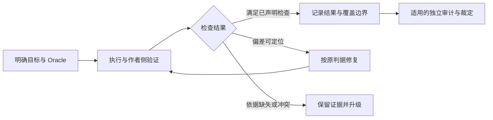

# 可验证的 Agent 工作回路

PM Agentic Cookbook 用目标、可定位的 Oracle、验证证据和停机条件组织工作。门禁负责可机判的约束，执行者依据失败证据修复或升级；规格的业务正确性仍需要懂业务的人判断。

本文说明已存在的检查与协作机制，以及尚未自动化的边界。阶段顺序见 [流程概览](overview.md)，门禁与宿主契约的详细格式见 [Kit 架构规范](kit-architecture.md)。

## 1. 回路的最小输入

| 输入 | 要说清什么 |
| --- | --- |
| 目标与范围 | 要产出什么，处理哪些对象，完成判断覆盖到哪里 |
| Oracle | 已确认的文件、规则或模型及其版本；口头信息先固化为文件，再作为后续判断依据 |
| 验证方式 | 哪些约束可由命令检查，哪些需要逐条比对或人工判断；无法核对的部分如何记录 |
| 失败处置 | 属于实现偏差、规格缺口还是输入不足；修复由哪个对象的 owner 承接 |
| 停机条件 | 满足哪些检查才结束；什么情况下暂停、保留证据并交用户裁定 |

Oracle 是判断依据，实现是被判断对象。不能复制实现结果作为期望值，也不能为了得到绿色结果而降低原来的判据。规格缺失或冲突时，先解决判断依据，再继续实现。

下图表示执行者组织的工作回路，箭头不代表门禁脚本会自动重试、修改产物或派发 skill：



## 2. 已实现的机检门禁

通用聚合命令为 [doc-sync.mjs](../tools/gates/doc-sync.mjs)，包含九道门禁：

| 门禁 | 检查什么 | 不能据此证明什么 |
| --- | --- | --- |
| [verify-skill-frontmatter](../tools/gates/verify-skill-frontmatter.mjs) | skill 目录、frontmatter、自包含引用及共享 reference 一致性 | skill 的方法是否有效、是否真正按条件加载 |
| [verify-skill-generic-layer](../tools/gates/verify-skill-generic-layer.mjs) | 通用规则中的领域词与写死的 Provider 路径 | 所有隐含领域假设都已被识别 |
| [verify-skill-host-paths](../tools/gates/verify-skill-host-paths.mjs) | 宿主声明的私有路径片段及明确豁免上下文 | 未进入词表的私有信息也一定没有出现 |
| [verify-decision-format](../tools/gates/verify-decision-format.mjs) | 决策档案格式、目录状态、必需章节与链接 | 备选真实、裁定正确或实现已经满足裁定 |
| [verify-no-section-sign](../tools/gates/verify-no-section-sign.mjs) | 本轮改动文件中的章节号符 | 未触及的全部存量文件都已检查 |
| [verify-translation-sync](../tools/gates/verify-translation-sync.mjs) | sidecar 元信息、同目录原文存在性与 raw blob 版本对应关系 | 英文语义忠实；滞后警告已处理 |
| [verify-skill-packages](../tools/gates/verify-skill-packages.mjs) | 各 skill 的 `.skill` 安装包成员、内容与执行位是否与源文件一致 | 通用 Prompt 的内容正确；没有生成安装包的 skill 也可分发 |
| [verify-agent-guide](../tools/gates/verify-agent-guide.mjs) | `AGENT_GUIDE.md` 路由表与 skill 目录、frontmatter `name` 一致，`llms.txt` 链接可解析；两份入口都不存在时跳过 | 路由描述的意图与 skill 实际能力相符 |
| [verify-changelog](../tools/gates/verify-changelog.mjs) | 各 skill 与根 CHANGELOG 的版本标题格式与递减顺序；skill 行为文件有改动时 CHANGELOG 同步改动 | 升哪一位版本号合乎规则；条目内容准确 |

宿主可通过 `gates.extraGates` 追加自己的检查。具体检查数量取决于宿主配置；配置未启用的检查会按该门禁的规则跳过并说明，不应算成已执行的覆盖。

Explicit gate status codes are `0` for no blocking violation, `1` for reported violations, and `2` for reported configuration or execution failure. A stale translation emits a warning and still returns `0`. The aggregator runs all registered gates and returns the worst exit code, ordered `2 > 1 > 0`; configuration loading fails before gate execution when the configuration is invalid. The aggregator preserves child statuses `0` and `1` and maps other statuses, including signal termination, to `2`; it aggregates status rather than diagnosing the underlying cause. Read the original output when classifying a failure.

From the cookbook root:

```sh
node tools/gates/doc-sync.mjs
```

门禁不修复文件。绿色退出码只覆盖已启用、实际扫描到的约束，不能直接解释为产品、业务规则或全部资产通过。

### 持续集成的消费边界

工具包提供聚合命令和注册样例，没有自带 CI workflow。CI 可以调用同一聚合命令，让非零退出码使检查步骤失败，并保留警告与原始输出；接入与运行情况需要宿主自己的记录证明。

CI environments must provide Node.js and Git, valid host configuration, and the comparison reference/history required by incremental checks. Hook execution additionally requires Bash. Hooks do not replace a direct gate invocation in CI or a delivery check.

## 3. Hooks：检查与提醒的触发器

[注册样例与脚本](../tools/hooks/) 把检查接到支持的事件入口。注册在宿主侧完成，检查路径与命令读取 `cookbook.config.json`；有脚本不等于宿主已经注册或实际触发。

| hook | 触发与作用 | 不负责什么 |
| --- | --- | --- |
| [post_edit_verify.sh](../tools/hooks/post_edit_verify.sh) | 编辑/写入事件提供有效文件路径后，按真实路径归属运行三道 skill 门禁或决策格式门禁；其他目录不处理 | 不运行完整 doc-sync，不自动审计产物 |
| [stop_checks.sh](../tools/hooks/stop_checks.sh) | 在配置的监视路径存在 uncommitted changes 时运行文档聚合命令；对代码改动另发一次自查提醒 | 不执行代码审查、不自动修复、不阻断会话结束 |
| [spec_capture_reminder.sh](../tools/hooks/spec_capture_reminder.sh) | 监视路径存在 uncommitted changes 时提醒可调用 spec-capture | 不执行沉淀、不把提案自动写入规则 |

三个 hook 把问题作为消息报告，不以非零退出码阻断会话；门禁命令自己的退出码才是检查结果。Stop 检查在宿主不属于 Git 仓库、或配置无法取得时会报告原因。

代码自查提醒按改动签名去重，签名覆盖 tracked diff 和 untracked 文件内容。同一组改动只提醒一次，新增文件继续变化也会改变签名。提醒去重不表示自查已经执行。

编辑后检查依赖事件输入格式。工具包的 Claude Code 示例注册编辑后事件和两个 Stop hook；Codex 示例只注册两个 Stop hook。不同宿主应使用与自身事件格式匹配的 adapter，不把一个宿主的 payload 形状当作通用能力。

所有监视字段都允许显式空数组关闭相应动作。未触发、无事件路径、路径不适用或动作关闭时，不能从没有消息推断检查通过。

## 4. Skill 的完成与升级边界

完成检查结束的是当前 skill 的工作，不构成用户批准或独立认证。各 skill 的准确条件由其 `SKILL.md` 定义，下面是核对入口和主要边界：

| skill | 完成检查 | 暂停或升级情形 |
| --- | --- | --- |
| [source-intake](../skills/source-intake/SKILL.md#停机条件) | 四问有结论、档位获确认、未决项已裁定、源材料索引可用 | 同一缺口两轮仍无答案，或补材料后四问仍无法收敛 |
| [domain-modeling](../skills/domain-modeling/SKILL.md#停机条件) | 自检有结论、图示语法有效、实体/关系/规则可追溯且推断有标注 | 输入冲突、缺关键业务事实，同处语法两次修复仍失败 |
| [acceptance-criteria](../skills/acceptance-criteria/SKILL.md#停机条件) | 来源/覆盖/五列/三档状态和编号核对完成，草稿交用户逐条确认 | 最终范围/模型未确认、依据缺失/冲突或落点缺失；未确认时不进入PRD |
| [create-prd](../skills/create-prd/SKILL.md#停机条件) | 应有章节与待补清单齐全、模型和图示引用真实、自检完成 | 上下文冲突、底层模型缺失/错误，同一缺口两次追问仍无答案 |
| [check-prd](../skills/check-prd/SKILL.md#停机条件) | 适用维度都有结论、报告与元信息齐全、发现有位置或明确缺失证据 | 没有被审文档，或依据冲突/缺失使整维无法判断 |
| [consistency-audit](../skills/consistency-audit/SKILL.md#停机条件) | 条目有判定或未核对说明，缺失有检索记录，偏差可复现，临时改动已还原 | Oracle 冲突妨碍多数高后果条目，或快照无法读取/不符 |
| [ui-generator](../skills/ui-generator/SKILL.md#停机条件) | 自检和代码缺陷自查完成、能构建、页面可打开 | 缺页面字段/交互依据，同处构建错误两次修复仍失败 |
| [table-template-designer](../skills/table-template-designer/SKILL.md#停机条件) | 自检与代码缺陷自查完成 | 列、分区、联动规则缺失，或与已有表格规范冲突 |
| [test-authoring](../skills/test-authoring/SKILL.md#停机条件) | 目标已确认、用例落地并实跑、代码自查完成、失败有分类和定位 | 期望有歧义，同一测试两次修复仍失败且无法定位；无实现时只写用例规格并声明无实现可测 |
| [journey-audit](../skills/journey-audit/SKILL.md#停机条件) | 覆盖清单有优先级/核验点；运行审计有逐步证据、累计覆盖与视觉盲区、证据等级 | 缺步/损坏使一半以上步骤无法判定，或 PRD 缺口使整个旅程不可判定 |
| [spec-capture](../skills/spec-capture/SKILL.md#停机条件) | 必要性判断有结论、提议可追溯、获批规则已写入及相关包已重建 | 阶段范围不明、复用性不确定，或与现有规范冲突；无规则可提取时结束，不凑条目 |

等待业务依据时，应保留已经取得的证据和未决清单。不能靠删掉业务层、放宽断言或自补裁定让回路继续运行。

### 验收标准与人工阶段回流

已确认模型之后，由acceptance-criteria生成独立清单并交用户逐条确认，PRD第4.2节引用清单、第10.2.1.4逐行细化；测试与旅程清单使用清单名称加编号，并登记未覆盖及取舍。来源章节与版本必须可定位，生成草稿不表示确认完成。

下游发现上游缺漏时，执行者暂停受影响工作并回改最上游依据；验收行置为待确认，记录来源阶段，确认后同步下游并重新验证。审计者只报告，获授权作者修订；门禁/hook仍不自动派发、修复或推进阶段。这是人工执行契约，不能据此宣称自动失败回流已存在。

需求范围在准入初划、建模验证、标准生成前最终确认；各范围一组标准/台账，模块只索引，共享模型不复制。跨范围共同端到端出口另核集成范围，子范围通过不代替集成。范围数量不决定Task数或增加审计轮次。

已声明功能/迭代开发与测试完成后做阶段回看；阶段六以[验收台账](../templates/tob_acceptance_register.md)逐条核对当前适用路径及证据，核对结果与用户结论分列。部分满足须有同一标准的成功与失败证据；只测成功、其余未测是证据不足；确定反例不能被未知掩盖。满足加用户明确通过才核销本版本/范围，偏差接受和延期不改事实结果。标准、实现或范围变更影响旧结论时重验，当前视图与可定位历史快照保留版本及原裁定，不凭旧绿色继承。证据汇总为人工流程，门禁不提供业务验收认证，进入验收不自动多一轮全量审计。

## 5. 独立审计与证据回收

作者侧验证和独立审计分别提供不同证据。作者侧负责代码缺陷自查、测试、变异与回放；审计者核对声明的规则和产物，不能采信作者的“已修”作为事实。

审计标准按对象和问题选择，materiality 决定深度：

| 问题 | 核对方式 |
| --- | --- |
| 需求文档本身是否充分、合理 | check-prd |
| 数据模型本身的质量 | 独立执行 domain-modeling 的质量自检清单 |
| 两类对象是否一致，规则在全部路径是否成立 | consistency-audit |
| 运行中旅程是否可达、完整、一致 | journey-audit |
| 代码本身是否有缺陷 | 作者侧代码缺陷自查 |

作者不能审自己的产物。首次审计与全量重审使用 fresh 实例；定向复核可复用未修改产物的独立审计者，但必须重新读取当前文件与 Oracle 取证。派发时给足 Oracle、对象清单、版本、输出位置、未读范围和完成标准。底层模型相同也可以建立新的独立实例，独立性取决于上下文与是否参与产物生成或修复。

一致性核对需要枚举全部可达入口，同时查两个方向：规则要求的是否实现，产物中额外行为是否声明。部分路径成立、另一路径失效，应记录为“部分成立”，不能用常测路径或整体测试绿色代替全路径证据。

报告附覆盖范围、未读/未核对项、检索记录、可复现命令和证据等级。P0/P1 发现由另一实例尝试反驳，原报告和异议分别保留。高后果判断没有执行证据时，应明确证据限制。

主 Agent 回收后原样转呈原报告，并将发现与核销状态放进宿主的问题登记表。原文保留版本历史中的来源提交、路径与 hash 后，才删除临时文件；结果文档不为保存审计历史而链接过程记录。目录落点由宿主契约的 `host.processRecordsDir` 决定。

Task 全部改动完成并通过作者侧验证后，执行一次独立收尾审计，覆盖整个 Task 与登记表全部未关闭条目；进行中的保存不触发审计。P0/P1 在任务内修好，由同一审计者只复核相关问题及影响路径一次；低成本 P2/P3 作者侧修复，其余给下一 Task。只有修复改变契约、模型或范围时才重新全量审计。

作者修复前列出同一口径涉及的全部文件、模板、镜像和生成物；修复后给出逐项证据及未处理边界。只改主体而漏掉附录、模板或另一个输出形式，仍是部分修复。仅作者侧修复保持“待后续审计确认”，不能借此直接核销或额外固定一轮审计。

详细派发、风险深度与证据生命周期见 [Agent 执行协议](agent-execution-protocol.md)。业务判断按批交用户，交付动作遵守宿主授权；文件保存和提醒事件本身不是新的审计实例。

## 6. Eval：设计接口与判卷纪律

触发层与质量层分别回答“会不会调用”和“产出是否满足要点”，不能合成一个通过率。接口与加载边界见 [架构中的 eval 约定](kit-architecture.md)。

| 层 | 目录接口 | 判断方式 |
| --- | --- | --- |
| 触发层 | `evals/trigger-evals.json`：`query`、`should_trigger`、可选 `note` | 对正向与兄弟 skill 的反向请求分别核对触发结果 |
| 质量层 | `evals/cases/<case-id>/`：`input.md`、`expected-points.md`、`notes.md` | 按运行前固定的可勾选要点逐条判定；记录不可判项 |

判据在运行前固定，被试与判卷分离，判卷结果不能由作者自证。通用 case 使用合成材料；需要真实业务材料的 case 按领域 Provider 边界隔离。skill 示例与评测靶点不能同源，避免把示例复述误当作泛化能力。答案和判据应隔离于被试可读目录，记录实际加载文件、替身依赖和执行边界。

缺必要输入导致的未产出，应区别于执行者遗漏。真实运行和使用替身的结果应分别标明；原始产物、运行方式与要点命中共同构成判断依据。判据失效时不能事后更改标准并沿用原结果，应先修评测设计，再进行新的运行。

触发判断必须有对应材料和动作场景。因材料缺失先追问，只证明执行者暂停，不能当成已经完成选 skill 的判断；反向没有唤起目标 skill，也不自动证明正确选择了兄弟 skill。应分别记录缺材料、正确选择、误触发和未进入选择的情况。

对照组用于区分模型已有能力与 skill 的行为约束。保持提示、材料、工具许可和运行方式一致，说明不同判卷者、单次样本与不适用要点的影响；不能把“合规停下”的组和“继续产出”的组简单比较总分。停下后无法触达的条目判无法判定，已可观察的边界仍逐项检查。

逐维输出等执行纪律需要事件顺序证据。只在对话中输出的运行，不能证明写文件逐步追加的分支；曾读取全部标准再统一交付，也不能因为最终报告完整就算逐维执行。不同入口或修订后的规则应分别验证，不沿用旧结果证明新规则。

这些规则说明评测如何执行，不证明每个 skill 已有完整的实跑覆盖或已经建立稳定基线。eval 语料从源目录运行，分发包不带 `evals/`；执行结果由使用方保存在自己的过程记录中。

## 7. 未自动化的回路

以下是路线图，当前门禁和 hook 不执行这些自动动作：

| 方向 | 目标与实施前提 |
| --- | --- |
| 失败自动回流 | 检查失败后自动携带上下文进入 owning 阶段。需要先固定失败分类、责任边界、重试/停止条件，以及原始判据的保全方式 |
| 重复失败自动生成提案 | 同类失败再次出现时生成 capture 提案。需要先定义跨报告如何识别“同类”、怎样保留证据及去重；提案生成与规则入库分开，入库仍需裁定 |
| 业务 Oracle 门禁 | 将可机判的状态集、权限集合或计算规则与实现做差集/测试。需要可信的业务规格与机器可读映射，未知或冲突不能解释为通过 |

机检能力越强，规格的错误也可能被更稳定地执行。循环必须保留人对业务事实、Oracle 和规格变更的判断；自动发现、自动重试或提醒都不能替代这层责任。
