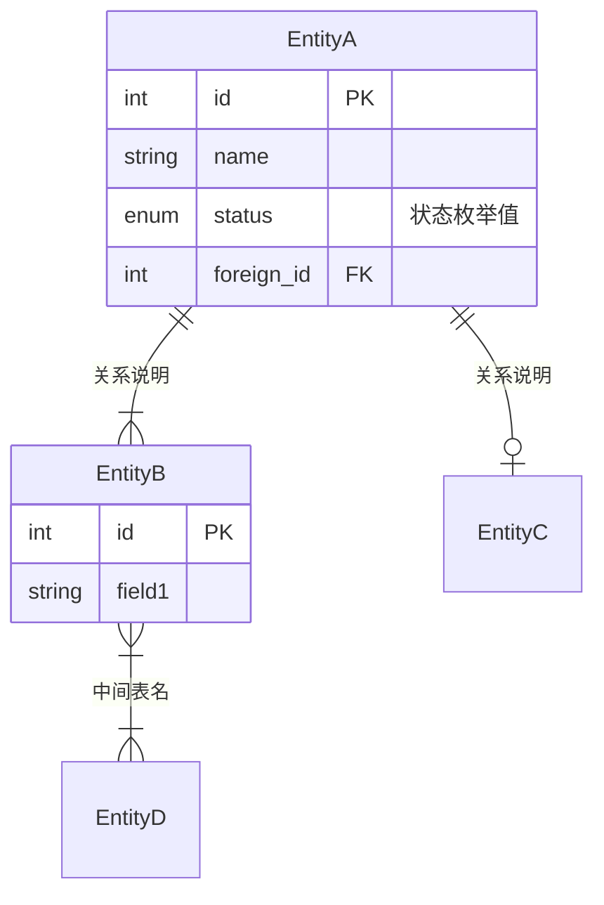
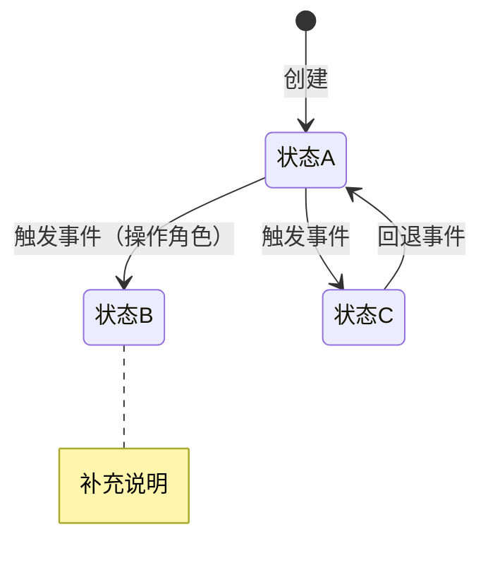

# Create-PRD 完整独立 Prompt

> 本文件是 create-prd 技能的完整独立版本，可在任何 LLM 中直接使用。

> 将本文件内容粘贴到 ChatGPT / Gemini / DeepSeek / Claude 等 LLM 中，
> 然后提供你的业务上下文，即可生成结构化 PRD。

> 需要领域补充规则时，明说按哪个领域写，并把该领域 Provider 的文件（skill 的 `references/providers/<domain>/` 下）一并提供。

---


============================================================

## SKILL

<!-- Derived from pmYangKun/create-prd-skill; modified by PM Agentic Cookbook contributors. SPDX-License-Identifier: Apache-2.0. See LICENSE and NOTICE. -->

# create-prd

根据用户提供的业务上下文和需求背景，生成结构化的、带有初始内容的 B端 PRD 文档。

本 skill 默认面向 B 端系统，并可按业务领域加载对应的领域 Provider（`references/providers/<domain>/`），生成该领域的功能模块级 PRD。它不限定产品形态，既可用于商业化 SaaS，也可用于企业自研系统、私有化交付和二开项目。

支持用户点名调用和自动触发（当用户明确要求创建、撰写 PRD、需求文档、产品方案或企业系统设计时）。

## 输入

- 用户提供的业务上下文和需求背景（自由文本、会议纪要、简要描述等均可）
- 或调用方给出的文件路径
- 范围内经用户逐条确认的验收标准清单（名称、路径与版本；引用使用清单名称加编号）
- 最终已确认需求范围及其所有关联模型/PRD，清单与台账位置；跨模块归集位置由调用方明确，文件数不决定范围数
- 当前项目中已有的上下文材料（如已存在的 PRD、Domain Model、解决方案文档、模块文档、术语表、权限说明、数据模型、交互原型等）

调用方随调用给出的参数，优先作为输入源。

同一范围可关联多份模型/PRD；引用唯一清单，不按每份PRD另造标准。范围变化先交用户确认并回改上游，受影响标准重新确认后才细化。模块入口只索引范围、模型/PRD、标准清单、台账及进度。PRD不复制交付台账，不把标准“已确认”写成“已实现”或用户已验收。

## 生成流程

严格按以下顺序执行，不可跳过或调换步骤。

### 阶段 0：理解上下文与产品定型

1. 完整阅读并理解用户提供的所有业务上下文。生成新PRD或补强需求语义前，先核对已确认Domain Model和验收标准清单；缺模型先回建模，清单缺失、相关条目待确认或与模型冲突时，停下回到验收标准阶段补齐并请用户确认，不能在PRD内从零定义完成标准。
2. 如果在项目工作区内生成 PRD，先检索并阅读与当前模块相关的已有文档，尤其是：
   - 解决方案或源材料文档
   - 当前模块的 Domain Model / 数据模型
   - 相邻模块 PRD 或已实现文档
   - 术语、权限、状态机、接口、数据流相关文档
3. 从用户描述和项目上下文中推断：
   - **商业属性**：商业化产品 or 企业自研系统
   - **功能类型**：业务型管理软件 / 工具型软件 / 交易型平台 / 基础服务型
   - **领域补充规则**：调用方指定的领域及是否已加载其 Provider；未指定时记"未指定"（不从上下文判定，见第 7 步）
   - **文档范围**：0-1 系统级规划 / 功能模块级需求 / 子功能详细需求 / 迭代需求
4. 用一句话向用户呈现推断结果，请求确认：

> 根据你的描述，这是一个【{商业属性} × {功能类型}】需求，领域补充规则：{调用方指定的领域，或"未指定"}，文档范围为【{文档范围}】{，简要理由}。我会据此调整 PRD 各章节的侧重点。如有不对请纠正。

5. 等待用户确认后再继续。
6. 确认后，加载定型参考文件以确定各章节的适配规则：

产品定型与章节适配

7. **领域由调用方显式给出，不从上下文里猜。** 调用时指定了领域，且 `references/providers/<domain>/` 下有对应 Provider，就加载该目录下的领域附录；没有指定就按通用框架生成，并在产出中声明"未加载领域补充规则"。**本文件不写死任何一个领域的路径**——加一个领域是加一个 Provider 目录，不改本文件。

### 阶段 1：前置章节（1-9章）

按顺序生成第1至第9章。默认每完成一章立即输出；如果用户要求落盘到文件或生成 PRD 包，则先在文件中完整生成，再输出摘要和自检结论。

每章加载对应的生成指引：

1. 第1章 项目背景
2. 第2章 需求基本情况
3. 第3章 商业分析
4. 第4章 项目收益目标
5. 第5章 项目方案概述
6. 第6章 项目范围
7. 第7章 项目风险
8. 第8-9章 术语与参考文献

### 阶段 2：核心功能需求（第10章）

这是 PRD 中最大、最核心的章节。加载生成指引：

9. 第10章 功能需求

按子章节分段生成：
- 10.1 产品框架概述（架构图 SVG——按文档范围选类：系统级=系统框架图+应用架构图，模块级=功能模块架构图；数据模型引用或局部数据模型图、业务流程图 SVG、状态机图、功能清单）
- 10.2 产品需求详解（逐模块：流程图 → 页面交互 → 业务规则）
- 10.3 异常情况处理方案

### 阶段 3：后置章节（11-14章）

10. 第11章 数据埋点
11. 第12章 角色和权限
12. 第13章 运营计划
13. 第14章 待决事项

### 阶段 4：自检与缺口分析

所有章节生成完毕后，执行轻量自检：

14. 自检与待完善清单

## 补强模式（对已有 PRD 做增量补充）

当用户提供一份已有 PRD 并要求补充页面交互、字段级规则或其中某几章时，不重新生成整份 PRD，改为增量补强：

1. 完整阅读既有PRD与其依据文档（Domain Model、已确认验收标准清单、Overview、相邻Sub PRD），确定范围；补强涉及的新业务预期未被确认清单覆盖时，先回改上游并确认，再补PRD。
2. 只加载与补强目标相关的章节指引（补页面字段级规则时加载第10章指引，按其"页面交互规则块 A-I"执行）。
3. 建立「页面/弹层 × 规则块」覆盖矩阵：清点 PRD 中出现的每个页面、弹窗、抽屉，对照 A-I 标出已覆盖与缺失。
4. 逐页补齐缺失的规则块，写入既有 PRD 的对应章节；不改动已有内容的口径与编号体系，发现与既有内容冲突时标注"待确认"而非覆盖。
5. 无法从上下文推断、必须由产品经理拍板的具体值（长度上限、默认值、文案等）给出建议值并标注 `[TODO: 待确认]`。
6. 当本次补强改变 PRD 正文、业务规则或产品语义时，在 PRD 修改记录中新增一行说明范围；仅做展示层维护时遵循下方“PRD 版本记录边界”。随后执行阶段 4 自检。

## 验收引用与回流

第4.2节引用已确认清单的名称、路径/版本与适用条目，不复制整份主表。第10.2.1.4每行写“清单名称 AC-n”，细化页面前置、操作与断言，不改变来源行的业务预期。发现新标准或冲突时暂停受影响工作，将缺口回到最上游依据：模型错先修模型，再修清单并将受影响行置为待确认，变更记录注明PRD阶段。未获修改授权时只交回缺口；获授权时可以形成清单修订草稿，仍须等用户确认。确认后同步PRD、覆盖清单和测试引用，不能自行批准或仅在PRD内新增一条验收规则绕过清单。 回流清单的文首状态字段用“草稿”，既有行可仍为已确认；“部分已确认”不作文件状态。清单标题可带版本或真实快照定位，不能编造原版本。页面Then每行只核一个可观察结果，多项细化可拆行引用同一标准；无来源的新增业务结果仍须回改上游。

## 输出规范

### 文档格式

默认以单个 Markdown 文档输出 PRD。对于复杂业务模块，允许输出 PRD 包：

- **Overview PRD**：描述模块目标、范围、信息架构、全局状态机、跨模块数据流、子 PRD 索引。
- **Sub PRD**：描述某个二级菜单或子功能的页面交互、字段、规则、异常、权限、验收标准。

单文档结构如下：

```md
# {产品/项目名称} PRD

| PRD 审核人 | {待填写} |
| --- | --- |
| 重要性 | {高/中/低} |
| 紧迫性 | {高/中/低} |
| 需求方 | {从上下文推断或标注待填写} |
| PRD 编写人 | {用户姓名或待填写} |
| PRD 提交日期 | {当前日期} |

## PRD 修改记录

| 变更时间 | 变更内容 | 变更提出部门与理由 | 修改人 | 审核人 | 版本号 |
| --- | --- | --- | --- | --- | --- |
| {当前日期} | 初始版本 | — | {编写人} | {待填写} | v1.0 |

---

## 1. 项目背景
...（各章节内容）

## 14. 待决事项
...

---

## 附：待完善清单
...
```

### PRD 版本记录边界

- 新增、删除或修改需求范围、业务规则、字段、状态、流程语义、权限、异常处理、验收口径或待决事项时，MUST 新增修改记录并递增版本号。
- 仅修复展示层或文档载体，且不改变任何正文内容或产品语义时，MUST NOT 为该维护动作单独新增 PRD 版本。例如：修正 SVG 连线锚点与排版、修复表格视觉样式、调整不影响信息含义的文档格式。
- 判断依据是语义差异而非改动文件类型：若图表修复改变了节点、分支条件、状态值、字段集合或流程关系，仍属于 PRD 内容变更，必须登记版本。
- 纯维护改动可由 Git 变更记录、提交说明或资产历史追溯，不占用 PRD 业务版本号。

### 内容生成规则

1. **有信息则生成实质内容**：根据用户提供的上下文，尽可能生成具体、有实质内容的初稿。
2. **信息不足则标注 `[TODO]`**：对于用户未提供足够信息的部分，用 `[TODO: 具体需要补充什么]` 标注，而不是编造内容。
3. **区分产品类型**：商业化产品与企业自研系统的内容侧重点不同，严格按照产品定型结果调整。
4. **理论框架外显**：在关键章节中，用简短提示说明所使用的方法论框架，帮助用户理解设计依据。
5. **结构化优先**：表格、列表、图表优先于大段叙述。
6. **图表载体**（三类图无条件按载体归位，不使用 ASCII 伪图；不设"视情况升级"的条件判断，避免同一类图在不同 PRD 里载体不一致）：
   - **架构类图统一使用手绘 SVG 图片**——含**系统框架图、应用架构图、功能模块架构图**三类及 API 结构图。三类架构图**场景与内容不同、不可相互替代**（系统框架图=系统有哪些业务域/模块；应用架构图=系统如何技术分层；功能模块架构图=单个模块的内部构成与上下游契约），但**载体、色带结构范式与视觉样式必须一致**；按文档范围选类的规则见第10章 第 10.1.1 节。架构图天然是分层多节点结构，Mermaid 渲染必然出现连线交叉、文字溢出、层级失衡，且无法表达分层色带与分组嵌套。
   - **业务流程图统一使用手绘 SVG 图片**（第 10.1.3 节 总览与 第 10.2.x.1 节 节点级），按总-分结构组织。流程图必须让读者复原**真实**业务流转：泳道按参与方/系统划分、形状区分处理步骤与状态落地点、**每条连线标注「动作/接口」+「状态：精确状态值」两行信息**、异常与回退路径标注密度与主干一致。只画主干、把环节概括成几个方框的图不合格（详见第10章 第 10.1 节「业务流程图的信息密度要求」）。
   - **ER 数据模型与状态机图使用 Mermaid**（`erDiagram` / `stateDiagram-v2`）——两者是关系/状态语义图，Mermaid 自动布局足够且便于 diff。仅当单图实体或状态数量过大导致渲染明显失真时才改 SVG，并在图注说明改用理由。
   - 规范详见第10章生成指引。
7. **跨模块一致性优先**：PRD 中的数据流、状态流、权限和术语必须与已有项目文档保持一致；如发现冲突，标注为“待确认/待修正”，不要私自覆盖既有模块口径。
8. **可自评，不可自我宣告通过**：AI 应对生成的 PRD 给出客观的成熟度自评（覆盖度、待完善项、check-prd 自审结果与评分）并如实展示——这是要求，不是禁区。但 PRD 任何位置（含修改记录“理由”列、待决事项结论、自检结论）都不得出现替用户下达“通过/成功”结论的自我背书，例如“PRD 成熟度满足评审要求”“数量合理”“通过 N 维度终审/封板”。审查动作如实描述其性质（如“AI 参考 check-prd skill 进行 N 维度自审”），而非“终审/审计通过”；**是否通过、是否进入下一步由用户裁定**，审核人字段在用户裁定前保持“待填写”。
9. **审议过程不进 PRD**：被否决的方案、已关闭的裁定项，不在 PRD 里保留专门的「已裁定项 / 已关闭项」表格——那是审议记录，归决策档案。PRD 只保留三样：变更记录里一行"本版关闭了什么"、正文里的规范取值与范围边界结论、以及**实现与规范有意不一致时的偏离登记**（读规范的人必须当场看到，否则会把有意为之的偏离当成缺陷）。判据：删掉这一行，实现者会不会做错？不会就不该留在 PRD。
10. **引用必须就地可理解、可追溯**：不要把 `BR-009`、`G-B`、规则块字母、节点缩写等内部编码当作正文含义。若当前位置已写出完整规则，删除冗余编码；若跨文档引用确有追溯价值，使用“可理解的规则名称 + 可跳转 Markdown 链接”，并在首次出现时说明编码含义。验收编号、待决事项编号等局部标识只在确有逐项追踪需要时保留，且定义位置必须同时给出完整内容。

11. **过程性编号绝不写进 PRD**（含变更记录）：审计发现号、走查观察号、待办清单项号、执行计划的裁定编号——这些编号的定义住在**过程性文档**里（审计报告、走查记录、执行计划、待办清单），而过程性文档在任务结束后会被清理。PRD 长期存在，于是编号悬空：读者读到它，在任何现存文档里都查不到它指什么。

    判据：**这个编号在本 PRD 内能否被解释？不能的话，读者要去哪里查？那个地方会不会消失？**

    | 编号来自 | 例 | 处理 |
    | --- | --- | --- |
    | **过程性文档**（会被清理） | 审计发现号、走查观察号、任务待办号、裁定项号 | **不写**。用实质描述代替——"审计 N-02 收口"改成"计划锁定时点冲突收口"，信息量不减反增 |
    | **结果性文档**（长期存在） | Domain Model 的业务规则号、PRD 内定义的规则号、权限点编码、TBD 登记号 | 可用，但按上条给出可理解名称 + 可跳转链接，不留裸编码 |

    变更记录尤其容易中招：它天然记录"这一版因为什么改了什么"，而"因为什么"常常是一个过程性编号。**变更记录的职责是让读者知道这一版改了什么**，用读者查不到的编号写就没尽到职责。

12. **遇到即修**：编辑 PRD 的任何一节时，若该节存在悬空的过程性编号，在同一次变更里改成实质描述。不做全文档批量清理，但也不绕过——存量靠每次编辑顺手收敛。

### 跨模块所有权迁移与证据唯一性

1. 页面或流程迁移到其它模块后，原 PRD 只保留模块间 contract：输入输出、幂等键、状态/引用回写和失败补偿边界。
2. 原 PRD 删除已迁出页面的字段、按钮、容器和权限细节；页面规格只由新 owner 的 PRD 定义，禁止两个 PRD 同时充当 UI Oracle。
3. 功能清单显式标记本 PRD owner 与外部 owner，避免把外部页面计入本模块实现范围。
4. 业务流程图、状态机图、SVG 和截图必须与当前 owner/contract 一致。需要保留旧图时，解除正文引用并标记为 historical，不得继续作为实现依据。
5. 修改记录保留历史事实；当前正文、引用和验收标准统一指向现行 Oracle。
6. 跨模块强约束必须形成生产者与消费者双向合同。生产者 PRD/Domain Model 定义可供读取的唯一性、状态与快照边界；消费者 PRD 同步落到入口/页面阻断、服务端守卫、异常处理和验收场景。只在上游写“下游应校验”不能视为合同闭合。
7. 当消费者依赖“上游对象 + 时间坐标唯一确定一条记录”时，必须分别定义零条与多条的处理；两者均为数据完整性异常，不得由消费者临时选择、回退默认记录或静默继续。

### 图表生成规则

第10章产品框架概述中，各图表按以下规定载体生成：

| 图表类型 | 载体/语法 | 必须包含 |
| --- | --- | --- |
| **系统框架图**（系统级 PRD） | **手绘 SVG**（`{系统名}-系统框架图.svg`） | 色带：用户与角色、各业务域分组、平台与公共能力、基础数据与外部系统 |
| **应用架构图**（系统级 PRD） | **手绘 SVG**（`{系统名}-应用架构图.svg`） | 色带：用户层、接入层、业务服务层（含平台能力）、数据层、外部系统 |
| **功能模块架构图**（功能模块级 PRD） | **手绘 SVG**（`{模块名}-功能模块架构图.svg`） | 色带：用户与接入层、业务服务层（核心业务+平台能力）、数据层、外部系统与相邻模块 |
| ER 数据模型 | `erDiagram` | 系统级 PRD 包含核心实体；功能模块级 PRD 优先引用已有 Domain Model，只补充本功能涉及实体 |
| 业务流程图 | **手绘 SVG 图片**（存模块文档目录的 `assets/`，不使用 Mermaid flowchart） | 总-分结构（第 10.1.3 节 总览 + 第 10.2.x.1 节 节点级）；参与方/系统泳道；形状区分处理步骤与状态落地点；每条边标注「动作/接口」+「状态：精确值（含子状态）」；主流程+关键分支+异常回退路径同密度标注 |
| 状态机图 | `stateDiagram-v2` | 正常+异常路径，附 note 说明约束 |

**注意事项：**
- Mermaid 图（ER / 状态机）后面附对应的明细表格作为补充说明（如状态机图+状态转换表）；SVG 图（架构 / 流程）后面附分层或流程的文字说明
- Mermaid 图内节点文字用 `<br/>` 换行，保持简洁
- **绘制任何 SVG 前先加载项目的图示规范 spec**（宿主契约 `host.specMap` 的 `ui-ux` 角色中的图示规则：形状字典、泳道规则、边标注密度、色板与样式类命名）；项目若无该 spec，先与用户确认基准并落成 spec 再动手。**同一项目内所有 SVG 共用一套色板与样式类**（架构图与流程图不分家），并检索同项目各模块 `assets/` 目录中既有的 SVG 作为视觉基准。`assets/` 是本 skill 自己的产物约定：图示放在模块文档目录的 `assets/` 下，需求文档用相对路径引用，从需求文档所在目录逐级上溯到模块文档目录（需求文档在子目录里几层，就上溯几层）。模块文档目录取宿主契约的 `host.moduleDocs`（把其中的 `<module>` 换成模块名），未声明时停下请用户指明；系统级需求文档不属于任何模块，图示放在它所在目录的 `assets/` 下
- **绘制完成后两道校验缺一不可**：① 运行 `scripts/validate_flow_svg.py`（流程图默认模式、架构图加 `--mode arch`）查箭头落点/孤立节点/起止节点/文本重叠；② **渲染成 PNG 用眼睛看**（`qlmanage`/浏览器）——脚本查不出标签拥挤、图例可读性、箭头贴边观感、整图清晰度。只跑脚本没渲染=没画完。语义层（状态值是否与 Domain Model 一致）另需人工与 check-prd
- **边标注：状态只写一处**——由目标状态落地点节点承载，边只标动作；不要在边上重复 `状态：…`（两处都写会在短线上叠字，是高频缺陷）
- 具体模板和示例见第10章生成指引文件

### 逐章输出规则

- 默认每完成一章立即输出；如果用户要求产出文件或 PRD 包，可以先生成文件，再输出章节摘要、文件路径和自检结论。
- 每章必须有清晰的章节标题，与 PRD 模板结构一致。
- 结构化数据（字段、权限、规则等）优先使用表格。
- 使用 `> 💡 方法论提示：` 引用块来呈现所应用的理论框架。
- 不确定的内容用 `[TODO]` 标注，并说明需要补充什么信息。

## 停机条件

同时满足才算完成：

- 范围内业务完成口径均引用已确认验收标准；上游缺口已回改并获确认，没有用页面细化替代用户裁定。

1. 按文档范围应有的章节都已产出；信息不足处保留骨架并标注待补，没有编造具体数值
2. 待决事项与待完善清单列全，每条写明缺什么、由谁补
3. 引用的数据模型、上位文档与图示路径都真实存在
4. 按待完善清单完成自检

**停下交用户**：上下文与已有数据模型或源材料冲突；数据模型缺失或有误、导致需求文档的底层逻辑无从落地——先补模型，不跳过模型直接写需求文档；同一处缺口连续两次追问仍无答案。

生成的是待评审的草稿，不宣告"可以开发"。

## 工作风格

- 目标是生成一份可用的 PRD 脚手架，加速产品经理的工作，而不是替代其判断。
- 用户上下文充分时，尽量具体和有实质内容；信息不足时，坦诚标注缺口。
- 保持专业的 PRD 写作风格：精确、结构化、无歧义。
- 根据用户提供的上下文丰富度调整深度——一段话的上下文生成轻量 PRD，详细上下文生成丰富 PRD。
- 如果用户提供的上下文非常有限，生成结构框架并附带指引说明，主动询问哪些补充信息有助于充实关键章节。


============================================================

## create-prd-appendix-typing

<!-- Derived from pmYangKun/create-prd-skill; modified by PM Agentic Cookbook contributors. SPDX-License-Identifier: Apache-2.0. See LICENSE and NOTICE. -->

# 产品定型与章节适配

> 在阶段 0 完成产品定型后加载此文件，用于确定各章节的内容侧重和适用性调整。

## 产品定型矩阵

### 商业属性（二选一）

| 属性 | 定义 | 典型场景 |
| --- | --- | --- |
| **商业化产品** | 面向外部客户销售的软件产品（含 SaaS、私有化部署、混合模式） | SaaS CRM、行业解决方案、通用工具类 SaaS |
| **企业自研系统** | 企业内部使用的业务系统，不对外销售 | 内部 CRM、ERP、OA、数据平台、运营后台 |

### 功能类型（四选一）

| 类型 | 特征 | 设计侧重 | 典型产品 |
| --- | --- | --- | --- |
| **业务型管理软件** | 多角色协同、长业务链、复杂场景 | 流程设计、角色权限、数据建模、状态机 | ERP、CRM、SCM、HRM、OA |
| **工具型软件** | 单一问题域、短业务链、个人使用为主 | 效率优化、极简体验、快速上手 | 电子签章、视频会议、文档协作 |
| **交易型平台** | 撮合交易、涉及支付结算和履约 | 交易闭环、支付结算、多边市场、商品管理 | 电商平台、采购平台、OMS |
| **基础服务型** | 抽象共享能力、供其他系统调用 | API 设计、可扩展性、稳定性、多租户 | 权限中心、支付中心、消息推送 |

### 业务领域（补充识别）

| 领域 | 识别方式 | 适配要求 |
| --- | --- | --- |
| **通用 B 端** | 未出现明确垂直行业或领域约束 | 按商业属性和功能类型适配 |
| **有 Provider 的垂直领域** | 出现该领域 Provider 声明的识别关键词 | 加载对应领域附录，按其适配要求强化相应章节 |
| **其它垂直领域** | 出现明确行业或业务域，但无对应 Provider | 在通用 B 端框架上保留行业术语和规则，**不擅自套用其他领域的约束** |

业务领域不替代商业属性。同一个领域既可以是商业化 SaaS，也可以是企业自研、私有化交付或二开项目。

## 章节适配规则

根据产品定型结果，以下章节需要做差异化调整：

### 第3章 商业分析

| 产品类型 | 调整方式 |
| --- | --- |
| 商业化产品 | **完整生成**：目标市场与客户分析（市场规模、市场特征、发展趋势、客户画像、客户痛点、卖点提炼）+ 竞品分析（商业模式、目标客户、运营策略、市场份额、产品分析、核心价值） |
| 企业自研系统 | **替换为**：同类系统调研（内部现有系统、外部参考系统）+ 业务痛点优先级排序。不需要市场规模和竞品市场份额分析 |

### 第4章 项目收益目标

| 产品类型 | 调整方式 |
| --- | --- |
| 商业化产品 | 商业目标（营收、客户数、续费率、NPS）+ 产品目标（功能使用率、活跃度） |
| 企业自研系统 | ROI 分析（投入产出比）+ 效率提升目标（节省工时、降低错误率）+ 采纳率目标 |

### 第10章 功能需求

| 功能类型 | 特别关注 |
| --- | --- |
| 业务型 | ER 数据模型图必须完整、跨部门泳道流程图、状态机、角色权限矩阵 |
| 工具型 | 核心使用流程极简、操作效率指标、快捷操作设计 |
| 交易型 | 交易闭环（下单→支付→履约→结算→售后）、商品管理、营销能力 |
| 基础服务型 | API 接口设计、多租户隔离、性能指标、SDK/文档 |

### 第10.1节 产品框架概述

**架构图类型由「文档范围」决定**（三类不可互相替代）：

| 文档范围 | 架构图要求 |
| --- | --- |
| 0-1 系统级规划 | **系统框架图 + 应用架构图（两张都要）**——前者讲系统由哪些业务域/模块组成，后者讲技术如何分层 |
| 功能模块级 | **功能模块架构图**（本模块内部构成 + 在系统中的位置 + 上下游契约） |
| 子功能级 | 不新增架构层，**引用**上级 Overview/模块 PRD 的架构图并声明覆盖节点 |
| 迭代级 | 沿用现有架构图；仅当改变架构层次或上下游契约时更新并在修改记录说明 |

**其余图表由「功能类型」决定**（载体见括注）：

| 功能类型 | 除架构图外必须包含的图 |
| --- | --- |
| 业务型 | ER数据模型图（Mermaid）+ 泳道业务流程图（SVG）+ 状态机图（Mermaid） |
| 工具型 | 核心使用流程图（SVG） |
| 交易型 | ER数据模型图（Mermaid）+ 交易流程图（SVG）+ 状态机图（Mermaid） |
| 基础服务型 | API 结构图（SVG）+ 调用流程图（SVG） |

> 载体规则统一见 SKILL.md「图表生成规则」与第10章指引 10.1.1：**三类架构图与所有流程图用手绘 SVG 且同项目同色板，ER 与状态机用 Mermaid**，不按图的复杂度做条件切换。

### 第12章 角色和权限

| 功能类型 | 调整方式 |
| --- | --- |
| 业务型 | 完整 RBAC 设计，权限精确到页面元素级别，含数据权限（组织架构树） |
| 工具型 | 简化角色设计（通常只有管理员/普通用户），重点在功能权限 |
| 交易型 | 多边角色设计（买方/卖方/平台），含交易相关的特殊权限 |
| 基础服务型 | API 级别的权限控制（API Key、OAuth、Rate Limiting） |

### 第13章 运营计划

| 产品类型 | 调整方式 |
| --- | --- |
| 商业化产品 | 获客策略 + 客户成功 + 续费策略 + 种子客户计划 + 产品上线推广 |
| 企业自研系统 | 内部推广 + 培训计划 + 试点部门策略 + 采纳率跟踪 + 运营流程建设 |

### 商业化 SaaS 特殊章节

如果产品是商业化 SaaS，以下内容**必须额外关注**：

- **第3章**：补充 SaaS 关键指标预估（CAC、LTV、MRR、Churn Rate），LTV/CAC > 3 为健康基线
- **第10章**：多租户架构设计（DB/Schema/Table/Row 级别隔离策略）
- **第10章**：配置化能力设计（参数配置、对象编辑器、流程编辑器）
- **第13章**：种子客户策略 + 从项目制到产品化的演进路线

### 0-1 新系统 vs. 迭代需求

| 文档范围 | 调整方式 |
| --- | --- |
| 0-1 新系统/系统级规划 | 所有章节完整生成，架构层（应用架构、数据架构、集成治理）完整设计；10.1.1 出**系统框架图 + 应用架构图**两张 SVG |
| 功能模块级需求 | 第1-4章简化为模块背景、业务目标和收益；第5-7章聚焦模块范围、上下游边界和风险；第10章聚焦本模块页面、流程、规则、异常、状态；第12章只写受影响角色和权限；10.1.1 出**功能模块架构图**一张 SVG |
| 子功能详细需求 | 以 Overview PRD 或上级模块 PRD 为前提，只展开单个二级菜单/页面/能力的入口、交互、字段、规则、异常、权限和验收标准；10.1.1 **引用**上级架构图并声明覆盖节点，不新增架构层 |
| 迭代需求 | 明确改造前后差异、影响范围、兼容策略、数据迁移和回归范围；不重复无关系统级背景 |

### 复杂模块 PRD 包

当功能模块级需求包含多个二级菜单、多个状态机或多个复杂数据来源时，优先拆分为 PRD 包，而不是强行写成单个超长文档。

| 文档 | 适用内容 |
| --- | --- |
| Overview PRD | 模块目标、信息架构、全局流程、状态机、跨模块关系、子 PRD 清单 |
| Sub PRD | 单个二级菜单或子功能的页面交互、字段、规则、异常、权限、验收标准 |

### AI 功能相关

如果用户描述中涉及 AI 功能，在第10章中额外应用：

- **确定性-容错性四象限模型**：根据任务特征选择 AI 交互模式
- **六脉神剑交互模式**：封装 API / CUI 嵌入 GUI / Chat / Copilot / 辅助填充 / 后台自动化
- **AI 可靠性设计**：降级方案、输出质量保障、数据隐私
- **AI 监控指标**：问题解决率、准确率、使用深度、弃用率


============================================================

## create-prd-ch01-background

<!-- Derived from pmYangKun/create-prd-skill; modified by PM Agentic Cookbook contributors. SPDX-License-Identifier: Apache-2.0. See LICENSE and NOTICE. -->

# 第1章 项目背景 — 生成指引

> 基于用户提供的业务上下文，生成 PRD 第1章"项目背景"的指引文件。

## 章节目标

用清晰、有数据支撑的语言描述项目的来龙去脉，让当前和未来的文档阅读者理解这个项目为什么要做。

> 💡 方法论基础：《决胜B端》三层业务调研框架（战略层→战术层→执行层）+ 五环节调研法

## 生成结构

```md
## 1. 项目背景

### 1.1 业务现状
{描述当前业务运行状况：组织架构、核心业务流程、现有系统/工具、关键业务数据}

### 1.2 面临问题
{列出当前面临的核心问题，按优先级排序：}
1. **{问题1标题}**：{具体描述，尽量附带数据}
2. **{问题2标题}**：{具体描述}
3. ...

### 1.3 解决思路
{概述本项目的解决方向和核心策略}

### 1.4 决策依据
{列出支持本项目立项的关键数据和事实}
```

## 生成规则

### 信息充足时

1. **业务现状**：从用户描述中提取组织背景、业务模式、现有系统，用简洁的段落描述。
2. **面临问题**：从用户的痛点描述中，按"影响范围 × 严重程度 × 紧迫度"排序，每个问题一句话概括+一句话展开。
3. **解决思路**：提炼用户描述中的方案方向，用1-2段概括。
4. **决策依据**：如果用户提供了数据（效率数据、成本数据、业务量数据），整理为要点列表。

### 信息不足时

- 业务现状：基于产品类型生成框架性描述，用 `[TODO: 请补充具体的业务数据，如日均订单量、团队规模、现有系统名称等]` 标注。
- 面临问题：如果用户只提了一句话需求，至少推断出2-3个可能的业务痛点（基于产品类型的常见问题），并标注 `[TODO: 请确认以下问题是否准确，并补充优先级]`。
- 解决思路和决策依据：生成模板框架，标注需要补充的内容。

### 不同产品类型的侧重

| 产品类型 | 背景侧重点 |
| --- | --- |
| 商业化产品 | 市场机会、客户痛点、商业价值假设 |
| 企业自研系统 | 业务现状（带数据）、效率瓶颈、管理层诉求 |

## 质量标准

- [ ] 背景描述有具体的业务场景，不空泛
- [ ] 问题描述有优先级排序
- [ ] 解决思路与问题一一对应
- [ ] 尽可能有数据支撑（即使是用户提供的粗略数据）


============================================================

## create-prd-ch02-basic

<!-- Derived from pmYangKun/create-prd-skill; modified by PM Agentic Cookbook contributors. SPDX-License-Identifier: Apache-2.0. See LICENSE and NOTICE. -->

# 第2章 需求基本情况 — 生成指引

> 生成 PRD 第2章"需求基本情况"的指引文件。

## 章节目标

用结构化方式记录需求的基本信息，确保需求的来源、对象、场景、价值都清晰可追溯。

> 💡 方法论基础：《决胜B端》需求发现十三要素五步法 — 第一步"分析角色"+ 第二步"了解基本场景"

## 生成结构

```md
## 2. 需求基本情况

| 要素 | 内容 |
| --- | --- |
| **需求提出人** | {从上下文推断或标注 [TODO]} |
| **功能使用人** | {列出主要使用角色} |
| **受影响人** | {列出虽不直接使用但受影响的角色} |
| **场景描述** | 见下方详细场景 |
| **发生频率** | {日均/周均/月均频次} |
| **核心痛点** | {一句话概括解决的是谁的什么痛点} |
| **需求价值** | {对业务的具体价值} |

### 核心场景描述

> 💡 场景六要素：人物、时间、地点、起因、经过、结果

**场景1：{场景标题}**
- **人物**：{角色名称}，{角色背景}
- **时间**：{典型发生时间}
- **地点**：{线上/线下，具体场景}
- **起因**：{触发这个需求的事件}
- **经过**：{当前的处理过程}
- **结果**：{当前结果及其问题}

**场景2：{场景标题}**
...（如有多个核心场景）
```

## 生成规则

### 信息充足时

1. **角色分析**：从用户描述中识别所有涉及的角色，按"十三要素"的三类（提出人、使用人、受影响人）分类。
2. **场景描述**：用场景六要素完整描述，确保每个场景都是具体的业务故事，而不是抽象功能描述。
3. **痛点挖掘**：用"五个为什么"（5Why）的思路，从表面需求追溯到根本痛点。
4. **频率和价值**：从用户的业务数据中推断。

### 信息不足时

- 基于产品类型推断可能的使用角色，标注 `[TODO: 请确认角色列表是否完整]`。
- 场景描述：至少生成1个主场景的框架，用 `[TODO]` 标注缺失的六要素。
- 痛点和价值：如果用户只说了"想做个XX系统"，推断2-3个常见痛点，标注需确认。

### 关键区分

| 概念 | 说明 | 示例 |
| --- | --- | --- |
| 需求提出人 | 提出这个需求的人（可能是管理层） | 销售总监 |
| 功能使用人 | 实际使用功能的人 | 一线销售人员 |
| 受影响人 | 不直接使用但工作受影响的人 | 财务（收到销售提交的报销） |

## 质量标准

- [ ] 三类角色（提出人/使用人/受影响人）都已识别
- [ ] 至少有1个核心场景用六要素完整描述
- [ ] 痛点描述具体，不是"提升效率"这类空话
- [ ] 频率和价值有估算（即使是粗略的）


============================================================

## create-prd-ch03-commercial

<!-- Derived from pmYangKun/create-prd-skill; modified by PM Agentic Cookbook contributors. SPDX-License-Identifier: Apache-2.0. See LICENSE and NOTICE. -->

# 第3章 商业分析 — 生成指引

> 生成 PRD 第3章"商业分析"的指引文件。此章节因产品定型不同而差异最大。

## 章节目标

从商业视角分析产品的市场空间、竞争格局和差异化定位，为后续功能设计提供商业依据。

> 💡 方法论基础：
> - 商业化产品：《决胜B端》产业链分析 + STP市场细分 + 竞品分析框架
> - 企业自研：《决胜B端》三层业务调研（战术层重点）+ 同类系统参考

## 生成结构 — 商业化产品

```md
## 3. 商业分析

### 3.1 目标市场与客户分析

| 分析维度 | 内容 |
| --- | --- |
| **目标市场** | {产品针对什么行业、什么市场} |
| **市场规模** | {TAM/SAM/SOM 估算，含数据来源} |
| **市场特征** | {市场现状、竞争格局概述} |
| **发展趋势** | {行业发展方向和驱动因素} |
| **客户画像** | {目标客户的典型特征：行业、规模、发展阶段、IT成熟度} |
| **客户痛点** | {目标客户群体的核心痛点} |
| **卖点提炼** | {一句话卖点：如果你是销售，如何打动客户} |

### 3.2 竞品分析

| 分析维度 | 竞品A：{名称} | 竞品B：{名称} | 我方产品 |
| --- | --- | --- | --- |
| **商业模式** | | | |
| **目标客户** | | | |
| **运营推广策略** | | | |
| **市场份额** | | | |
| **核心功能** | | | |
| **核心价值** | | | |
| **优势** | | | |
| **劣势** | | | |

### 3.3 差异化定位
{基于以上分析，阐述本产品的差异化竞争策略}
```

### SaaS 产品补充内容

```md
### 3.4 SaaS 商业模型预估

| 指标 | 预估值 | 说明 |
| --- | --- | --- |
| **目标定价** | {月费/年费，按版本分} | |
| **CAC（获客成本）** | {预估} | 含销售+市场费用 |
| **LTV（客户生命周期价值）** | {预估} | = ARPU × 客户生命周期 |
| **LTV/CAC** | {目标 > 3} | 健康基线 |
| **目标 Churn Rate** | {月度/年度流失率} | |
| **回本周期** | {月数} | CAC / 月ARPU |

> 💡 SaaS 健康基线：LTV/CAC > 3，回本周期 < 12个月
```

## 生成结构 — 企业自研系统

```md
## 3、业务分析与系统调研

### 3.1 同类系统调研

| 调研对象 | 类型 | 核心能力 | 可借鉴点 | 局限性 |
| --- | --- | --- | --- | --- |
| {内部现有系统A} | 内部 | | | |
| {外部参考系统B} | 外部 | | | |

### 3.2 业务痛点优先级

| 排序 | 痛点描述 | 影响范围 | 严重程度 | 紧迫度 | 涉及部门 |
| --- | --- | --- | --- | --- | --- |
| 1 | | | | | |
| 2 | | | | | |

### 3.3 投入产出初步评估

| 维度 | 估算 |
| --- | --- |
| **预计投入** | {人力、时间、预算概估} |
| **效率提升** | {预计节省的工时/降低的错误率} |
| **业务价值** | {对业务指标的预期影响} |
```

## 生成规则

### 商业化产品

1. 从用户描述中提取市场和客户信息，填充3.1表格。
2. 如果用户提到了竞品，填充竞品分析表；未提到则推断行业常见竞品并标注 `[TODO: 请确认竞品列表]`。
3. 市场规模如果用户未提供数据，标注 `[TODO: 请补充市场规模数据，可参考易观、艾瑞、IDC等报告]`。
4. SaaS 产品必须生成3.4节商业模型预估。
5. 差异化定位是核心：必须回答"为什么客户要选你而不选竞品"。

### 企业自研系统

1. 不需要市场规模和竞品市场份额。
2. 重点放在"同类系统调研"（内部有什么、外部有什么可参考的）和"痛点优先级"。
3. 必须包含投入产出评估，即使是粗略的。

### 信息不足时

- 根据产品类型生成完整的表格框架，核心字段用 `[TODO]` 标注。
- 对于可推断的字段（如根据行业推断常见竞品），给出推断并标注请确认。

## 质量标准

- [ ] 商业化产品：客户画像具体到行业+规模+阶段，不是"所有企业"
- [ ] 商业化产品：至少分析2个竞品
- [ ] 商业化产品：有明确的差异化定位（不是"我们更好"）
- [ ] 企业自研系统：痛点有优先级排序
- [ ] 企业自研系统：有投入产出评估
- [ ] SaaS产品：有SaaS关键指标预估


============================================================

## create-prd-ch04-goals

<!-- Derived from pmYangKun/create-prd-skill; modified by PM Agentic Cookbook contributors. SPDX-License-Identifier: Apache-2.0. See LICENSE and NOTICE. -->

# 第4章 项目收益目标 — 生成指引

> 生成 PRD 第4章"项目收益目标"的指引文件。

## 章节目标

定义清晰、可衡量的项目目标，确保项目有明确的成功标准和验收依据。

> 💡 方法论基础：SMART原则（具体、可衡量、可实现、相关性、有时限）

## 生成结构

```md
## 4. 项目收益目标

### 4.1 项目目标

| 目标类型 | 目标描述 | 衡量指标 | 目标值 | 达成时限 |
| --- | --- | --- | --- | --- |
| **核心业务目标** | | | | |
| **效率目标** | | | | |
| **体验目标** | | | | |

### 4.2 验收标准

依据：[{清单名称}]({清单路径})，版本：{版本}

| 验收标准 | 适用范围 / 对应PRD章节 |
| --- | --- |
| {清单名称 AC-n} | {本PRD细化的范围与章节} |

### 4.3 成功标准

> 项目上线后 {X} 个月内，达到以下指标视为成功：

1. {成功标准1，含具体数字}
2. {成功标准2}
```

## 生成规则

### 不同产品类型的目标侧重

| 产品类型 | 核心目标 | 常见指标 |
| --- | --- | --- |
| 商业化产品 | 商业价值 | 营收、付费客户数、续费率、NPS、市场份额 |
| 企业自研系统 | 业务效率 | 工时节省率、错误率下降、处理量提升、采纳率 |
| 工具型 | 使用效率 | 操作耗时缩短比例、日均使用次数、任务完成率 |
| 交易型 | 交易规模 | GMV、订单量、转化率、客单价 |

### 信息充足时

1. 从用户描述中提取目标，用 SMART 原则规范化（补充具体数字和时限）。
2. 验收标准引用已确认清单（名称加编号），不另建权威副本；区分交付验收与上线后成功指标。清单未覆盖的新业务结果先回改清单并确认，不在第4.2节从零定义。
3. 对于 2B 产品，很多时候难以衡量直接的价值收益，可以考量功能的使用率、满意度等。

### 信息不足时

1. 基于产品类型生成3-5个常见目标框架，具体数字标注 `[TODO]`。
2. 验收清单缺失、条目未确认或依据冲突时停下回补上游；性能、安全等标准仅在已有明确来源时引用，不能自动补固定指标。
3. 成功标准标注 `[TODO: 请与业务方确认上线后的成功标准和评估周期]`。

## 质量标准

- [ ] 每个目标都符合 SMART 原则（尤其是"可衡量"和"有时限"）
- [ ] 目标不是"上线"或"按时交付"，而是业务价值层面的
- [ ] 验收标准具名引用已确认清单、版本与条目；不复制主表或新增未确认口径
- [ ] 验收标准与成功标准有明确区分
- [ ] 目标数量合理（3-5个核心目标，不要面面俱到）


============================================================

## create-prd-ch05-overview

<!-- Derived from pmYangKun/create-prd-skill; modified by PM Agentic Cookbook contributors. SPDX-License-Identifier: Apache-2.0. See LICENSE and NOTICE. -->

# 第5章 项目方案概述 — 生成指引

> 生成 PRD 第5章"项目方案概述"的指引文件。

## 章节目标

用简要语言概述核心功能和项目方案，让读者在深入细节前对整体方案有全局认知。

> 💡 方法论基础：《决胜B端》自顶向下设计思路 — 先全景后细节

## 生成结构

```md
## 5. 项目方案概述

### 5.1 核心功能概述

本项目包含以下核心功能模块：

| 序号 | 功能模块 | 功能简述 | 优先级 |
| --- | --- | --- | --- |
| 1 | {模块名称} | {一句话描述} | P0/P1/P2 |
| 2 | | | |
| ... | | | |

### 5.2 方案概述

- **产品方案**：{核心产品策略，1-2句}
- **技术方案**：{关键技术选型或约束，1-2句}
- **运营方案**：{上线和推广策略概要，1-2句}

### 5.3 MVP 范围（如适用）

> 💡 B端 MVP 原则：必须支撑核心业务流程闭环，不是"最简单的版本"

**MVP 包含的功能：**
{列出 MVP 版本包含的功能及理由}

**MVP 暂不包含的功能：**
{列出延后的功能及延后理由}

**核心验证假设：**
1. {假设1：通过 MVP 要验证什么}
2. {假设2}

### 5.4 PRD 拆分方案（复杂模块适用）

当本需求属于功能模块级需求且包含多个二级菜单或复杂子流程时，补充 PRD 拆分方案：

| PRD 文件 | 覆盖范围 | 依赖关系 | 产出优先级 |
| --- | --- | --- | --- |
| {module}_prd_overview.md | 模块目标、信息架构、全局流程、状态机、跨模块数据流 | 依赖 Domain Model 和上游解决方案 | P0 |
| {module}_prd_{sub_function}.md | 单个子功能的页面、字段、规则、异常、权限、验收标准 | 依赖 Overview PRD | P0/P1/P2 |

拆分方案只描述文档和功能边界，不写入工具执行过程或内部协作流程。
```

## 生成规则

1. 功能模块从用户描述中提取，按业务逻辑（而非技术模块）组织。
2. 优先级标注：P0=必须有、P1=应该有、P2=可以有。
3. 如果是 0-1 新产品，生成 MVP 范围；如果是迭代需求，此节可简化。
4. 方案概述不展开细节，每个维度1-2句话即可，细节在后续章节。
5. 复杂模块必须判断是否需要 PRD 包；若需要，给出 Overview PRD 与 Sub PRD 的边界清单。
6. PRD 拆分以业务菜单、流程闭环、数据来源或角色工作流为依据，不按技术组件拆分。

## 质量标准

- [ ] 功能模块按业务逻辑组织，不按技术分
- [ ] 每个模块有清晰的一句话描述
- [ ] 有明确的优先级标注
- [ ] MVP 范围（如有）能支撑核心业务闭环
- [ ] 复杂模块已说明是否拆分 PRD 包及拆分边界


============================================================

## create-prd-ch06-scope

<!-- Derived from pmYangKun/create-prd-skill; modified by PM Agentic Cookbook contributors. SPDX-License-Identifier: Apache-2.0. See LICENSE and NOTICE. -->

# 第6章 项目范围 — 生成指引

> 生成 PRD 第6章"项目范围"的指引文件。

## 章节目标

明确项目涉及的系统、产品、接口和影响范围，提前识别关联方，避免遗漏。

## 生成结构

```md
## 6. 项目范围

### 6.1 涉及系统

| 系统名称 | 关系类型 | 影响描述 | 责任方 |
| --- | --- | --- | --- |
| {本系统} | 主体 | 新建/改造 | {产品团队} |
| {关联系统A} | 数据来源 | 需对接接口 | {对方团队} |
| {关联系统B} | 数据消费方 | 需提供接口 | {对方团队} |

### 6.2 影响范围

- **用户影响**：{哪些用户群体会受到影响}
- **流程影响**：{哪些现有业务流程会变化}
- **数据影响**：{是否涉及数据迁移、格式变更}
- **上下游影响**：{对上下游系统或业务的影响}

### 6.3 不在本期范围内

{明确列出本期不做的内容，避免范围蔓延}
1. {排除项1及排除理由}
2. {排除项2及排除理由}
```

## 生成规则

1. 从用户的业务描述中推断可能涉及的系统（如CRM、ERP、OA、支付系统等）。
2. "不在本期范围内"很重要 — 明确边界比扩大范围更有价值。
3. 如果信息不足，至少列出"本系统"行，其他标注 `[TODO: 请梳理与哪些系统有数据交互]`。

## 质量标准

- [ ] 所有涉及系统都已列出，含责任方
- [ ] 影响范围覆盖用户、流程、数据三个维度
- [ ] 有明确的"不在范围内"清单


============================================================

## create-prd-ch07-risks

<!-- Derived from pmYangKun/create-prd-skill; modified by PM Agentic Cookbook contributors. SPDX-License-Identifier: Apache-2.0. See LICENSE and NOTICE. -->

# 第7章 项目风险 — 生成指引

> 生成 PRD 第7章"项目风险"的指引文件。

## 章节目标

识别并记录项目的假设、约束和各类风险，每个风险都有应对方案。

## 生成结构

```md
## 7. 项目风险

### 7.1 前提假设

| 编号 | 假设内容 | 如果假设不成立的影响 |
| --- | --- | --- |
| A1 | | |
| A2 | | |

### 7.2 约束条件

| 编号 | 约束描述 | 对设计的影响 |
| --- | --- | --- |
| C1 | | |
| C2 | | |

### 7.3 风险清单

| 编号 | 风险类别 | 风险描述 | 发生概率 | 影响程度 | 应对方案 |
| --- | --- | --- | --- | --- | --- |
| R1 | 产品风险 | | 高/中/低 | 高/中/低 | |
| R2 | 运营风险 | | | | |
| R3 | 技术风险 | | | | |
| R4 | 合规风险 | | | | |
```

## 生成规则

### 风险类别指引

| 风险类别 | 常见风险 |
| --- | --- |
| **产品风险** | 需求变更、范围蔓延、用户接受度低、竞品抢先 |
| **运营风险** | 推广困难、培训成本高、数据迁移失败、用户抵触 |
| **技术风险** | 第三方依赖不稳定、性能瓶颈、数据安全、兼容性 |
| **合规风险** | 数据隐私（GDPR/个人信息保护法）、行业法规、审计要求 |

1. 从用户描述中识别显性风险（用户提到的担忧）。
2. 基于产品类型补充常见隐性风险（至少每类1个）。
3. 每个风险必须有应对方案，不能只列风险不给方案。
4. 信息不足时，基于产品类型生成3-5个典型风险，标注 `[TODO: 请评估概率和补充应对方案]`。

## 质量标准

- [ ] 覆盖产品、运营、技术三类风险（合规视情况）
- [ ] 每个风险有应对方案
- [ ] 前提假设和约束条件已列出
- [ ] 风险数量合理（3-8个，不要面面俱到也不要太少）


============================================================

## create-prd-ch08-09-terms

<!-- Derived from pmYangKun/create-prd-skill; modified by PM Agentic Cookbook contributors. SPDX-License-Identifier: Apache-2.0. See LICENSE and NOTICE. -->

# 第8-9章 术语与参考文献 — 生成指引

> 生成 PRD 第8章"术语和缩略语"和第9章"参考文献和引用文档"的指引文件。

## 生成结构

```md
## 8. 术语和缩略语

| 术语/缩略语 | 全称 | 定义说明 |
| --- | --- | --- |
| {从文档中提取的术语} | | |

> 注：尽量不要自己定义缩略语。如涉及公司内部缩略语，请明确其定义。

## 9. 参考文献和引用文档

| 文档名称 | 版本 | 链接/位置 | 说明 |
| --- | --- | --- | --- |
| | | | |
```

## 生成规则

1. **术语表**：回顾前面生成的所有章节，自动提取出现的专业术语和缩略语，生成术语表。
2. **参考文献**：如果用户提供了参考资料、竞品链接、内部文档等，整理到此处。
3. 如果文档中没有特殊术语，标注"本文档无需额外术语解释"。
4. 参考文献至少列出 `[TODO: 请补充相关的内部文档链接]`。
5. **正文引用可理解性**：跨文档引用写成“规则/章节的完整名称 + 可跳转 Markdown 链接”，避免只写 `BR-009`、`G-B`、`Overview 第 X 节`、节点标题缩写等读者无法就地理解的代码。
6. **编码最小化**：当前段落已经完整陈述规则时，不再附加内部编码。只有需要跨文档追溯、问题闭环或机器化关联时才保留编码，并在首次出现处说明含义、来源文档和直接链接。
7. **局部编号自解释**：验收场景、待决事项、规则表等局部编号必须与完整描述同时出现；后文引用编号时附描述性名称并链接到定义位置。无法提供稳定锚点时，直接复述必要内容。


============================================================

## create-prd-ch10-functions

<!-- Derived from pmYangKun/create-prd-skill; modified by PM Agentic Cookbook contributors. SPDX-License-Identifier: Apache-2.0. See LICENSE and NOTICE. -->

# 第10章 功能需求 — 生成指引

> 生成 PRD 第10章"功能需求"的指引文件。这是 PRD 中最核心、最大的章节。

## 章节目标

以结构化方式详尽描述产品的功能设计，包括产品框架、功能详解和异常处理。

> 💡 方法论基础：
> - 产品框架：《决胜B端》自顶向下设计（框架图→数据模型→流程→页面→权限→字段）
> - 数据建模：《决胜B端》ER建模三步法（找实体→梳关系→定属性）
> - 流程设计：《决胜B端》UML 建模（泳道图 + 状态机）
> - 交互设计：《决胜体验设计》设计价值观 + 四大设计原则（有用、高效、容错、启发）
> - 规则描述：《决胜B端PRD模板》五种规则类型（事实、约束、触发条件、推论、计算）

## 生成结构

### 10.1 产品框架概述

图表载体按类型固定，**不做"视情况升级"的判断**——同一类图在任何 PRD 中载体一致：

| 图类型 | 载体 | 理由 |
| --- | --- | --- |
| **架构图三类**（系统框架图 / 应用架构图 / 功能模块架构图，以及 API 结构图） | **手绘 SVG** | 分层多节点结构，需要分层色带与分组嵌套，Mermaid 无法表达且必然连线交叉。三类图场景不同但结构范式与样式一致，选用与分层构成见 10.1.1 |
| **业务流程图**（10.1.3 总览 + 10.2.x.1 节点级） | **手绘 SVG** | 需要泳道、判定分支着色、跨泳道虚线联动 |
| **ER 数据模型** | Mermaid `erDiagram` | 关系语义图，自动布局足够，便于 diff |
| **状态机图** | Mermaid `stateDiagram-v2` | 状态语义图，同上 |

Mermaid 两类图仅当单图实体/状态数量过大导致渲染明显失真时才改 SVG，并在图注说明理由；架构图与流程图**无此条件分支，一律 SVG**。

**SVG 通用规范**（架构图与流程图共同遵循）：存放于模块文档目录的 `assets/` 下，以相对路径引用（需求文档与 `assets/` 同级时如 ``，需求文档在模块目录的子目录里时，从所在目录逐级上溯到模块文档目录，子目录有几层就上溯几层，如一层时用 `../assets/`）。模块文档目录取宿主契约的 `host.moduleDocs`（`<module>` 换成模块名），未声明时停下请用户指明；系统级需求文档不属于任何模块，图示放在它所在目录的 `assets/` 下。SVG 是版本化产物，后续修改直接编辑该文件。

> **绘制前必须加载项目的图示规范 spec**（形状字典、泳道规则、边标注密度、色板与样式类命名）。项目若尚无该 spec，先与用户确认基准并落成 spec，再开始绘制——不要凭既有图"目测仿色"。项目 spec 未定义的通用规则以本节为准。

**同一项目内所有 SVG 共用一套色板与 CSS class 命名**（架构图与流程图不分家）——绘制前先检索同项目既有 `assets/` 目录中的 SVG 作为视觉基准，不要另起一套。

### 业务流程图的信息密度要求（通用层核心规则）

流程图的价值在于让读者复原**真实**业务流转。只画主干、把环节概括成几个方框的图不满足要求，无论排版多干净。

**总-分结构**：10.1.3 产出覆盖全流程的总览图；10.2.x.1 为每个功能节点产出节点级详细流程图，详述该节点的具体环节、判定分支与回退/作废流转；总览图的泳道与主干节点集应覆盖各节点级图的主干，节点级图只做细化、不得与总览矛盾。

**泳道划分按参与方/系统**（非仅人的角色）：跨系统协作的流程必须让每个系统各占一道，跨系统交接因而显性化为跨泳道连线。纵向主干自上而下推进，跨泳道联动用虚线。

**形状即语义**（同一形状不得表达两种含义）：起止用胶囊；**处理步骤**（有人或系统执行动作）用实心矩形；**判定**用菱形且每条出边标注条件；**状态落地点**（流程在此产生一个可被对方角色/系统观察到的状态，本身不执行动作）用**卷角文档形**——把可观察状态画成普通矩形会掩盖"该节点是干活还是只记录结果"。

**一步一节点**（严禁压缩）：一个节点只画一个环节。**禁止把「A → B → C」多个步骤塞进一个节点的文字里**——压缩会丢掉每步各自的状态、校验与失败分支，使流程不可追溯。顺序步骤必须拆成逐个独立节点、用箭头串联，一步一框。

**主干走泳道中心线**：主干节点居中于泳道，只有旁路分支（阻断框、旁注）才横向偏移——这样相邻主干节点用垂直直线相连，不必绕折线。

**泳道宽度按内容自适应**：泳道不强制等宽；含判定+旁路阻断或宽节点的泳道自动加宽以容纳内容，只有主干的泳道保持最小宽。**绝不为迁就固定泳道宽而压缩节点、截断内容或让节点溢出到相邻泳道**。泳道整体宽度与标题栏对齐（左右边距统一）。

**连线路由**：同列→垂直直连，同行→水平直连，真跨行跨列→单拐点正交折线（按主方向选拐向），不走斜线、不走多拐 Z 字；箭头精确落在目标节点边界（矩形边中点、菱形顶点），不停半空。

> **首选用生成器出图**：`scripts/flowgen.py` 从数据(泳道/节点/连线)生成流程图，坐标、连线路由、箭头贴边、泳道自适应、样式全自动——上述规则由生成器"构造即满足"，不靠人逐图遵守。用法见 `scripts/flowgen_example.py`。手写 SVG 仅作生成器暂未覆盖的一次性布局的兜底；手写时你要对本节每条规则负责。

**连线标注的核心（"真实流转图"与"概括示意图"的分水岭）：动作标在边上，状态由目标节点承载，状态只写一处、不重复。**

- **状态在一处**：一次流转的结果状态，由边指向的**状态落地点节点**承载（该节点的存在意义就是承载可观察状态）；边只标动作/条件。**不要在边上再写一遍 `状态：…`**——两处都写既冗余、又会在短水平线上与动作字叠成一团，是常见缺陷。仅当边指向处理步骤/判定、且无状态落地点节点承接时，才在边上补一行状态。
- **状态值精确到子状态**：存在子状态时必须写出括号内容，只写父状态不合格。
- **跨系统连线必须标注接口编号与同步内容**，使该边可回指集成规范。
- **回退/驳回/补材等异常路径的标注密度与主干一致**（动作标签 + 状态落地点）——异常路径标注不足是最常见缺陷。
- 状态值必须与本 PRD 状态机、Domain Model 枚举**逐字一致**。
- **标签不得压节点、不得与相邻标签重叠**：短线（<80px）放不下标签时，把状态并入目标节点、或删去冗余动作词，不要硬叠。

**阶段分组与状态聚合**：跨泳道的子阶段用强调色虚线框整体圈出；多个并列终态/分支状态收敛到同一后继时，用强调色分组框聚合后引一条边出去，避免逐条连线交叉。

**完整性**：
- **一图仅一个开始节点、一个正常结束节点**。不要为图省事摆多个"结束"——先让分支汇合，再收束到唯一终点；阻断终止（`stop`）不受此限，可有多个（每个记录一种中止原因）。若唯一终点会逼出死循环，必须显式解开：该分支要么落到阻断终止，要么明确回到需重试的步骤，**绝不留下无法退出的环**。
- 除起止节点外每个节点必须有入边和出边，无孤立或断头节点（说明卡片是旁注，豁免）；判定的每条分支都必须落到状态落地点、终态、阻断终止或汇回主干，不得悬空。
- 箭头必须精确落在目标节点边界上，不得停在半空（把折线拆成"带箭头短线 + 后续 path"是最常见成因，应合并为单条 path）。
- **禁止两条连线共线重叠**：同一水平/垂直线上叠两条边会让读者分不清箭头属于哪条路径。一个节点向同方向扇出多条边时必须逐条错开（生成器会自动把后续分支下移并改从底边引出）。
- **每张图底部必须有图例条**，列出本图用到的每种图形及其中文名，加上两种连线（同泳道流转、跨泳道/系统联动），使读者不离开图就能读懂所有图形。
- 每张图在正文中都要跟一段文字版流程说明。

**可用图形**（生成器 `type` 值）：`start` 起止 / `step` 处理步骤 / `decision` 判断 / `state` 状态落点 / `subprocess` 子流程（进入其它流程）/ `data` 数据落点 / `database` 数据库 / `docstack` 文件落点 / `note` 说明卡片 / `stop` 阻断终止。

> **绘制完成后必须做两道校验，缺一不可：**
> 1. **运行结构校验脚本** `scripts/validate_flow_svg.py`（流程图默认 `--mode flow`，架构图 `--mode arch`）：查箭头落点、孤立节点、起止节点、文本粗略重叠——这些肉眼极难查全（十几像素偏差、漏画的分支终点、叠字）。
> 2. **渲染成 PNG 用眼睛看**（`qlmanage -t -s 1400 -o /tmp/ *.svg` 或浏览器）：脚本查不出标签是否互相拥挤、图例是否可读、箭头是否落在菱形尖点还是边上、整图是否清晰。**只跑脚本没渲染 = 没画完**——只跑脚本、不渲染，图例糊成一团、边字重叠都发现不了。
>
> 两道校验都干净了才算完成。脚本与渲染都不替代语义审查（状态值是否与 Domain Model 一致、泳道划分是否合理仍需人工与 check-prd）。

#### 10.1.1 架构图（三类，按文档范围选用）

架构图分三类，**场景与表达内容不同，不可相互替代**；但三者的**载体、分层结构范式与视觉样式完全一致**——都是手绘 SVG、都是"自上而下若干条色带 + 带内分组 + 节点"的框架结构、都沿用同项目同一套色板与样式类。

**A. 三类架构图的选用**

| 图类型 | 适用文档范围 | 回答什么问题 | 文件命名 |
| --- | --- | --- | --- |
| **系统框架图** | 0-1 系统级规划 PRD | 这个**系统**由哪些业务域/子系统/模块组成，它们如何分组与分层 | `{系统名}-系统框架图.svg` |
| **应用架构图** | 0-1 系统级规划 PRD | 这个**系统**在应用/技术上如何分层，请求如何自上而下贯穿，外部系统如何接入 | `{系统名}-应用架构图.svg` |
| **功能模块架构图** | 功能模块级 PRD | 这**一个模块**内部由哪些功能节点与平台能力构成，它在系统中的位置、上下游契约与数据边界 | `{模块名}-功能模块架构图.svg` |

- **系统级 PRD**：系统框架图与应用架构图**两张都要**——前者讲"有什么"（功能域全景），后者讲"怎么搭"（技术分层）。二者视角互补，不可只画其一充数。
- **功能模块级 PRD**：画功能模块架构图；若上位系统级 PRD 已有系统框架图/应用架构图，本模块图应能在其中定位到自己的位置，不重复绘制系统全景。
- **子功能级 Sub PRD**：**不新增架构层**，引用上级 Overview / 模块 PRD 的架构图，并用一句话声明本 Sub PRD 覆盖其中哪些节点。写法：`引用 [Overview 10.1.1 功能模块架构图](上级文档.md#1011-功能模块架构图)；本 Sub PRD 覆盖其中「X」「Y」节点与「Z」平台能力，不新增架构层。`
- **迭代需求**：沿用现有架构图；仅当本次迭代改变了架构层次或上下游契约时才更新图，并在修改记录说明改动点。

**B. 各类图的色带构成**（结构范式一致，层内容按类型定）

**系统框架图**——按业务域/能力域分带：

| 色带 | 内容 |
| --- | --- |
| 用户与角色 | 系统面向的角色群体与终端形态 |
| 业务域分组 | 若干条按业务域划分的色带（如主数据域、业务办理域、分析域），带内以 `grp` 圈出子域，节点为具体模块；标注模块间主要流向 |
| 平台与公共能力 | 权限、审批、消息、集成、审计等横切能力 |
| 基础数据与外部系统 | 主数据源、外部系统清单 |

**应用架构图**——按技术分层分带：

| 色带 | 内容 |
| --- | --- |
| 用户层 | 终端形态（PC Web / 移动端 / 开放 API 调用方） |
| 接入层 | 认证、鉴权、网关、路由 |
| 业务服务层 | 核心业务服务分组 + 平台能力分组 |
| 数据层 | 数据库、缓存、文件/对象存储、日志与审计存储 |
| 外部系统 | 通过接口/事件/回调交互的外部系统，标注集成方式 |

**功能模块架构图**——按本模块视角分带：

| 色带 | 内容 |
| --- | --- |
| 用户与接入层 | 本模块的使用角色（按角色隔离或分级列出）、终端形态、认证与权限校验入口 |
| 业务服务层 | 上半部为**核心业务分组**（本模块的功能页面/流程节点），下半部为**平台能力分组**（状态门禁、鉴权求值、校验网关等横切能力） |
| 数据层 | 本模块拥有的数据实体、只读消费的外部主数据、审计/日志类存储 |
| 外部系统与相邻模块 | 上下游模块及其契约摘要（只读 / 事件 / 回调 / 交付物），标注读写方向 |

**C. 三类图共同的生成规则**

正文引用写法（三类相同，替换文件名即可）：

```md


{图后附分层文字说明：逐层交代该层承载什么、与相邻层的关系}
```

- SVG 用 `<defs><style>` 定义样式类（色带 `band`、分组 `grp`、节点 `box`、平台能力 `plat`、数据 `db`、外部 `ext`），节点复用类而非逐个内联样式，便于后续编辑与跨图一致
- **配色与样式类沿用同项目既有 SVG**（先检索 `assets/` 目录取基准）；无既有产物时，本图的色板即成为该项目后续所有 SVG（含流程图）的基准。三类架构图之间尤其必须同色板——它们常被并列阅读
- 色带内分组用浅色底 `grp` 圈出，组名左上角标注
- 跨层流向用实线箭头，旁路/求值/事件类联动用虚线箭头，箭头旁标注关系名
- 节点文字超过一行时用 `<tspan x="…" dy="…">` 换行，副说明用更小字号
- 外部系统节点下方用 `note` 小字标注契约摘要（如"主数据只读""定稿交付"）
- 图后必须附分层文字说明，不能只放图

#### 10.1.2 数据模型图或数据模型引用

系统级 PRD 或缺少前置数据模型时，使用 Mermaid `erDiagram` 语法，同时保留实体说明表格作为补充。

功能模块级 PRD 如果已有 Domain Model、ER 文档或数据模型文档，应优先引用既有模型，不重新发明完整 ER。此时输出“本功能涉及实体表”和“数据读写边界表”，只在确有必要时补充局部 ER。

> 💡 ER建模三步法：找到实体 → 梳理关系 → 确定关键属性

模板：

````md

````

**关系符号说明：**
- `||--||` 一对一
- `||--|{` 一对多
- `}|--|{` 多对多（通过中间表）
- `||--o|` 零或一对一

**生成规则：**
- 0-1 系统级业务型/交易型产品：ER图必须完整，所有核心实体和关系都要画出
- 功能模块级或子功能级 PRD：优先引用已有 Domain Model；只展开本功能涉及实体、字段、状态和读写边界
- 如果 PRD 发现数据模型缺口，输出“数据模型反馈项”，不要在 PRD 中私自修改既有模型口径
- 每个实体列出关键属性（PK/FK/状态/核心业务字段）
- 关系标注业务含义
- ER图后面附实体说明表格（补充属性细节和业务规则）

功能模块级模板：

```md
#### 10.1.2 本功能涉及实体与数据边界

| 实体 | 来源文档 | 本功能动作 | 关键字段/状态 | 说明 |
| --- | --- | --- | --- | --- |
| {EntityA} | {Domain Model 路径或章节} | 只读/新增/更新/锁定/归档 | {字段} | {规则} |

| 数据流 | 上游 | 本功能处理 | 下游 | 一致性约束 |
| --- | --- | --- | --- | --- |
| {数据流名称} | {上游模块} | {校验/计算/确认} | {下游模块} | {幂等/版本/锁定} |

**数据模型反馈项：**
- [TODO/无] {如发现既有模型缺少字段、状态或关系，在此列出}
```

#### 10.1.3 核心业务流程图

统一使用**手绘 SVG 图片**（总-分结构的"总"）：概括全流程环节与跨节点汇入关系，节点细节下沉到 10.2.x.1 节点级图。

**生成规则：**
- 分层/泳道布局：按角色或功能域分泳道，每条泳道纵向主干自上而下；跨泳道联动、系统触发用虚线边；平台级前置能力（如状态门禁）可画为横贯顶部的虚线带
- 节点符号：起止用椭圆、判断用菱形、普通步骤用圆角矩形；着色语义固定——蓝=主流程步骤、浅蓝=入口/系统触发、绿=成功/终态、红=失败/阻断
- 每条边带箭头，分支边标注条件；除起止节点外每个节点必须有入边和出边
- 节点文字简洁，可附业务规则编号辅助定位；图底附图例（实线/虚线含义）与指向节点级图的引用
- 文件存模块 `assets/`，命名 `模块名-核心业务流程图.svg`，Markdown 相对路径引用；沿用项目既有流程图 SVG 的配色与样式类

#### 10.1.4 状态机图

使用 Mermaid `stateDiagram-v2` 语法，同时保留状态转换表格作为补充说明。

模板：

````md

````

**生成规则：**
- 为每个有状态流转的核心实体画一张状态机
- 包含正常路径和异常路径（回退、超时等）
- 用 `note` 标注关键约束
- 状态机图后附状态转换明细表（当前状态→触发事件→目标状态→操作角色→备注）

#### 10.1.5 功能清单

| 子系统 | 页面 | PC端 | H5端 | App端 | 说明 |
| --- | --- | --- | --- | --- | --- |
| {子系统A} | {页面1} | ✓ | — | — | |
| {子系统A} | {页面2} | ✓ | ✓ | — | |

### 10.2 产品需求详解

对每个功能模块，按以下结构生成：

```md
### 10.2 产品需求详解

#### 10.2.1 {模块名称}功能详解

##### 10.2.1.1 业务流程图

{节点级详细流程图：手绘 SVG（总-分结构的"分"，样式与 10.1.3 总览图一致），详述本功能节点的具体环节、判定分支、阻断与回退/作废流转。每条边按 10.1 信息密度要求标注「动作/接口」+「状态：精确状态值（含子状态）」，异常与回退路径同密度；图后附文字版流程描述。文件存模块 `assets/`，命名 `模块名-{功能节点名}流程图.svg`}

##### 10.2.1.2 页面交互

**{页面名称}**

> 💡 设计原则：有用 > 高效 > 容错 > 启发
> 💡 页面字段级规则（字段格式、校验、联动、按钮状态、控件交互态、状态文案）是研发、测试、设计都无法替产品经理决定的内容。详细需求级 PRD 缺失这一层即不具备开发条件，不得只写"支持查询/支持编辑"一句带过。

**页面交互规则块（A-I）**：按文档范围选做（见下方"适用范围分级"）。

**A. 页面结构（区域 × 内容 × 交互）：**

| 区域 | 内容 | 交互 |
| --- | --- | --- |
| {顶栏/提示条/Tab/筛选区/列表/分页} | {元素清单，含按钮名} | {触发方式、区域间联动、切换时的保留与丢弃规则} |

**B. 查询条件与筛选控件规则：**

| 控件 | 字段类型 | 输入限制 | 触发规则 | 错误/空态 |
| --- | --- | --- | --- | --- |
| {搜索框} | 文本 | {长度上限、trim、禁止换行} | {回车/点击查询/选择即查} | {无结果文案} |
| {状态筛选} | 单选/多选下拉 | {默认选中项} | {是否自动提交} | {无权限选项的隐藏规则} |
| {查询/重置按钮} | 按钮 | — | {loading 防重复；重置后页码与条件的复位} | {失败 toast 文案} |

**C. 列表字段级规则：**

| 字段 | 显示格式 | 交互/校验 | 权限与状态 |
| --- | --- | --- | --- |
| {字段名} | {文本长度上限/日期格式/金额精度/枚举 Badge 颜色/空值占位符} | {超长省略+悬停完整值、可复制、点击下钻、排序} | {只读来源/可编辑条件/脱敏规则} |

**D. 表单/详情字段级规则**（新建、编辑、详情视图的每个字段）：

| 分区 | 字段 | 读写 | 控件/格式 | 必填条件 | 校验与联动 |
| --- | --- | --- | --- | --- | --- |
| {分组名} | {字段名} | 只读/可编辑/条件可编辑 | {控件类型、格式、精度、默认值} | {恒必填/条件必填（写清触发条件）} | {范围、上限、跨字段联动、失焦格式化、错误文案} |

**E. 操作按钮与行操作规则**（页面级按钮 + 行操作 + 弹层按钮全覆盖）：

| 按钮 | 展示条件 | 点击反馈 | 阻断条件 | 禁用态表现 |
| --- | --- | --- | --- | --- |
| {按钮名} | {权限、数据状态} | {loading、toast、跳转、二次确认} | {校验失败项清单} | {置灰 + 悬停 Tooltip 展示禁用原因} |

**F. 弹窗/抽屉/页面容器规范：**
- 容器类型选择（Modal / Drawer / 新页面 / Toast）及理由；宽度或尺寸档位。
- 只读模式与编辑模式的按钮组差异；顶部固定信息与 sticky 规则。
- 未保存变更时关闭/切换的二次确认文案；保存中的 loading 与防重复提交。

**G. 控件交互五态基线**（默认 / 悬停 / 聚焦或点击 / 错误 / 禁用）：

| 元素 | 默认态 | 悬停态 | 聚焦/点击态 | 错误态 | 禁用态 |
| --- | --- | --- | --- | --- | --- |
| {文本输入框/数字输入框/下拉框/日期选择器/表格行操作/主按钮/次按钮} | | | | | |

> 全局基线在系统级或 Overview 层登记一次即可；页面级只登记与基线的差异，避免逐页重复。

**H. 页面状态与文案：**

| 状态 | 触发条件 | 文案/交互 |
| --- | --- | --- |
| 首次加载 | {请求中} | {骨架屏/加载指示} |
| 空数据 | {无数据} | {业务化空态文案 + 引导动作} |
| 搜索无结果 | {筛选无结果} | {文案} |
| 无权限 | {整页无权限} | {文案} |
| 部分权限 | {有列表权限无敏感字段权限} | {字段级脱敏表现} |
| 加载/保存失败 | {后端或网络失败} | {toast 文案 + 字段级错误定位} |

**I. 敏感字段展示口径（如适用）：**
- 脱敏格式（写出具体掩码样式）、临时查看/隐藏交互、导出是否同口径脱敏、查看留痕要求。

**适用范围分级：**

| 文档范围 | 必做规则块 |
| --- | --- |
| 子功能详细需求 / 迭代需求 | A-I 全做；每个页面、每个弹层逐一覆盖 |
| 功能模块级需求 | 至少 A-E + H；G 可引用全局基线 |
| 0-1 系统级规划 / Overview PRD | 不做页面级明细；登记全局交互基线（G）与 Sub PRD 必须覆盖 A-I 的下钻要求 |

**字段级规则的最低粒度**（每个可编辑字段缺一不可）：控件类型、格式与精度（长度上限/小数位/日期格式）、默认值、必填条件（含条件必填的触发条件）、校验规则与错误文案、跨字段联动；只读字段须写明数据来源与是否脱敏。信息不足时保留表格骨架并标注 `[TODO: 需产品经理定义]`，不得编造具体数值后不作标记。

##### 10.2.1.3 业务规则

> 💡 规则五种类型：事实、约束、触发条件、推论、计算

| 编号 | 规则类型 | 规则描述 |
| --- | --- | --- |
| R1 | 约束 | {如：订单金额不可为负数} |
| R2 | 触发条件 | {如：当库存低于安全库存时，自动触发补货提醒} |
| R3 | 计算 | {如：订单总额 = Σ(商品单价 × 数量) - 优惠金额} |

##### 10.2.1.4 验收标准

| 验收标准（清单名称加编号） | 场景类型 | Given | When | Then |
| --- | --- | --- | --- | --- |
| {清单名称 AC-n} | 正常流 | {合法角色、合法数据、开放状态} | {执行操作} | {所引用标准的一项可观察结果} |
| {清单名称 AC-n} | 异常流 | {缺失/重复/冲突数据} | {执行操作} | {所引用标准的一个异常结果} |
| {清单名称 AC-n} | 权限流 | {无权限角色或越权数据} | {访问/操作} | {所引用标准的一项拒绝或不可见结果} |
| {清单名称 AC-n} | 锁定态 | {对象已审批/锁定/归档} | {尝试修改} | {禁止修改或进入解锁流程} |
| {清单名称 AC-n} | 幂等流 | {重复提交/导入/同步/回调} | {再次执行} | {不产生重复业务结果} |
```

### 10.3 异常情况处理方案

```md
### 10.3 异常情况处理方案

| 异常类型 | 异常场景 | 处理方案 |
| --- | --- | --- |
| 网络异常 | 提交操作时断网 | 本地暂存，恢复后自动重试/提示重新提交 |
| 并发冲突 | 多人同时编辑同一记录 | 乐观锁 + 冲突提示，后提交者需刷新确认 |
| 数据异常 | 外部系统返回错误数据 | 校验拦截 + 错误日志 + 人工处理入口 |
| 误操作 | 误删除重要数据 | 软删除 + 回收站 / 操作确认二次弹窗 |
| 业务异常 | 审批超时无人处理 | 超时提醒 → 升级提醒 → 自动转派 |
| {其他} | | |
```

## 生成规则

### 10.1 产品框架

1. **架构图**：按文档范围选类（系统级=系统框架图+应用架构图两张；功能模块级=功能模块架构图；子功能级=引用上级不新增），从第5章的功能模块表展开为色带结构，**均为手绘 SVG 且同色板**（10.1.1）。
2. **数据模型**：
   - 从业务描述中识别核心名词作为实体候选。
   - 用ER三步法：找实体→梳关系→定属性。
   - **系统级业务型/交易型**产品：ER模型必须完整，这是设计的基石。
   - **功能模块级/子功能级**需求：优先引用已有 Domain Model，避免 PRD 与数据模型漂移。
   - **工具型/基础服务型**：简化数据模型，重点在功能接口。
   - 关系要标注精确的基数（1:1, 1:*, *:*），不能模糊。
   - 考虑未来扩展性：宁可设计为*:*用中间表，也不要后期改模型。
3. **业务流程图**：**手绘 SVG** 泳道图（10.1.3 总览 + 10.2.x.1 节点级），至少覆盖主流程、关键分支与异常路径，图后附文字版流程描述。
4. **状态机**：为每个有状态流转的核心实体画状态机，包含正常和异常路径。
5. **功能清单**：用表格列出所有页面和多端支持情况。

### 10.2 需求详解

1. **每个模块**都按"流程图→页面交互→业务规则"三段式结构。
2. **页面交互**按 A-I 规则块生成，覆盖深度按"适用范围分级"表执行；详细需求级 PRD 的每个页面和弹层都要有字段级规则表，不得合并或抽样。
3. **业务规则**必须按五种类型分类：事实、约束、触发条件、推论、计算。
4. **验收标准**每行引用已确认清单名称与编号，将其细化为页面Given/When/Then，覆盖适用的正常、异常、权限、锁定及幂等场景。未被清单覆盖的新业务预期先回改上游并确认，不直接新增无来源的验收行。
5. 如果信息充足，生成具体字段和规则；如果不足，生成表格框架并标注 `[TODO]`。
6. **规则块间一致性**：E 表中每个按钮的阻断条件必须与 D 表校验规则、10.3 异常方案对应得上；H 表状态枚举必须与状态机和列表字段的枚举一致；页面中出现的每个按钮必须能在第 12 章权限矩阵中找到行。
7. **状态可达与派生优先级**：状态机的每个人工迁移必须落到某个页面的操作入口（写清按钮、前置条件、二次确认文案），系统迁移写明触发器；系统派生状态（红绿灯、健康度类）必须定义多条件同时命中时的展示优先级。
8. **无悬空引用**：Tab、入口按钮、业务规则引用到的每个页面/列表/弹层，都必须在本 PRD 内有规格或明确引用其所在文档；不允许"办理抽屉写全了、承载它的列表页不存在"。

### 10.3 异常处理

1. 至少覆盖：网络异常、并发冲突、数据异常、误操作、业务异常 5类。
2. 每种异常有具体的处理方案，不是"待后续补充"。

### AI 功能设计（如适用）

如果产品包含 AI 功能，在对应模块的需求详解中额外加入：

```md
##### AI 功能设计

> 💡 确定性-容错性四象限分析 + 六脉神剑交互模式选择

**任务特征分析：**

| 分析维度 | 评估 |
| --- | --- |
| 确定性 | 高（目标明确）/ 低（探索性） |
| 容错性 | 高（允许出错）/ 低（必须准确） |
| 推荐交互模式 | {六脉神剑中的具体模式} |

**AI 交互设计：**
- **交互模式**：{封装API / CUI嵌入GUI / Chat / Copilot / 辅助填充 / 后台自动化}
- **人机边界**：{哪些步骤AI执行、哪些需要人确认、哪些必须人操作}
- **降级方案**：{AI 不可用时的回退方案}
- **监控指标**：{准确率、使用率、弃用率等}
```

## 不同产品类型的侧重差异

| 功能类型 | 10.1 侧重 | 10.2 侧重 | 10.3 侧重 |
| --- | --- | --- | --- |
| 业务型 | ER图+流程图+状态机都必须完整 | 每个模块的角色交互和审批流程 | 审批异常、数据一致性 |
| 工具型 | 简化模型，强调使用流程 | 操作效率和快捷方式 | 数据丢失防护、撤销操作 |
| 交易型 | ER图+交易流程图+状态机 | 交易闭环各环节的规则 | 支付异常、库存并发、对账 |
| 基础服务型 | API结构+调用流程 | 接口规范和参数说明 | 服务降级、限流、重试 |

## 质量标准

- [ ] 10.1 架构图按文档范围选类齐备（系统级=系统框架图+应用架构图；模块级=功能模块架构图；子功能级=显式引用上级图并声明覆盖节点），且有功能清单
- [ ] 架构图与业务流程图均为 SVG 且样式与项目图示 spec / 既有 `assets/` 产物一致；ER 与状态机为 Mermaid
- [ ] 流程图达到信息密度要求：泳道按参与方/系统划分；形状区分处理步骤与状态落地点；**每条边标注动作/接口 + 精确状态值（含子状态）**；异常回退路径标注密度与主干一致；边上状态值与状态机/Domain Model 逐字一致
- [ ] **已运行 `scripts/validate_flow_svg.py` 且全部通过**（流程图 `--mode flow`，架构图 `--mode arch`）：箭头落点无指空、无孤立节点、起止节点齐备、无文本重叠
- [ ] **已渲染成 PNG 并目视确认**：标签不拥挤、图例可读、箭头贴节点、整图清晰——脚本查不出这些，必须眼睛看
- [ ] 10.1 系统级业务型/交易型产品有完整ER模型；模块级 PRD 已引用或局部说明数据模型
- [ ] 10.1 有状态流转的实体都有状态机
- [ ] 10.2 每个模块按"流程→交互→规则"三段式
- [ ] 10.2 页面交互按 A-I 规则块生成，深度符合"适用范围分级"
- [ ] 10.2 详细需求级 PRD：每个可编辑字段有控件/格式/必填条件/校验/错误文案，每个按钮有展示条件/反馈/阻断/禁用原因，每类页面状态有文案
- [ ] 10.2 规则按五种类型分类
- [ ] 10.2 验收标准覆盖正常、异常、权限、锁定、幂等场景
- [ ] 10.3 至少覆盖5类异常场景
- [ ] AI功能（如有）使用了四象限+六脉神剑框架


============================================================

## create-prd-ch11-tracking

<!-- Derived from pmYangKun/create-prd-skill; modified by PM Agentic Cookbook contributors. SPDX-License-Identifier: Apache-2.0. See LICENSE and NOTICE. -->

# 第11章 数据埋点 — 生成指引

> 生成 PRD 第11章"数据埋点"的指引文件。

## 章节目标

定义需要监控和追踪的用户行为数据，为后续运营分析和产品迭代提供数据基础。

> 💡 方法论基础：《决胜B端》数据埋点方法 — B端重点在功能采纳率和业务流程效率

## 生成结构

```md
## 11. 数据埋点

### 11.1 埋点策略

- **埋点目标**：{核心要回答的业务问题}
- **埋点工具**：[TODO: 请确认公司统一的埋点工具，如 GrowingIO / 神策 / 自研]

### 11.2 页面埋点

| 页面名称 | 事件名称 | 事件类型 | 采集参数 | 用途说明 |
| --- | --- | --- | --- | --- |
| {核心页面} | page_view | 页面曝光 | page_id, user_role | 监控页面使用率 |
| | | | | |

### 11.3 行为埋点

| 操作名称 | 事件名称 | 触发条件 | 采集参数 | 用途说明 |
| --- | --- | --- | --- | --- |
| {核心按钮操作} | btn_click_{action} | 用户点击 | action_type, target_id | 监控功能使用频率 |
| {关键流程完成} | flow_complete_{name} | 流程走完 | duration, step_count | 监控流程效率 |
| | | | | |

### 11.4 业务指标埋点

| 指标名称 | 计算方式 | 数据来源 | 统计周期 |
| --- | --- | --- | --- |
| {如：日均订单处理量} | count(order.status=completed) | 订单表 | 日 |
| | | | |
```

## 生成规则

1. **核心页面**必须有 page_view 埋点。
2. **核心操作**（创建、编辑、删除、审批、导出等）必须有行为埋点。
3. **关键流程**（从发起到完成的全链路）需要有流程完成埋点，含耗时。
4. B端产品特别关注：功能采纳率（用了/没用）、操作效率（耗时）、异常率。
5. 如果信息不足，基于第10章的功能清单自动推断需要埋点的核心页面和操作。

## 质量标准

- [ ] 核心页面都有曝光埋点
- [ ] 核心操作都有行为埋点
- [ ] 关键流程有完成率和耗时埋点
- [ ] 埋点参数包含角色信息（B端多角色场景下区分不同角色的使用情况）


============================================================

## create-prd-ch12-permissions

<!-- Derived from pmYangKun/create-prd-skill; modified by PM Agentic Cookbook contributors. SPDX-License-Identifier: Apache-2.0. See LICENSE and NOTICE. -->

# 第12章 角色和权限 — 生成指引

> 生成 PRD 第12章"角色和权限"的指引文件。

## 章节目标

以**角色权限定义表**的形式，把本模块的每一个权限点逐行声明清楚：它是什么、作用在哪个页面、是否涉敏、每个角色拿不拿得到。这张表要能被权限管理模块**机读**并直接录入，也要能作为实现层权限矩阵的**预言（oracle）**——测试照着它断言，多授或漏授都应失败。

> 💡 方法论基础：
> - 《决胜B端》RBAC 模型（用户→角色→权限集→菜单/页面/页面元素）
> - 三层权限控制：菜单级 → 页面级 → 功能元素级
> - 功能权限与数据权限**双轴分离**：成熟的权限系统一律把"能不能做"与"能对谁做"拆开配置、拆开求值

## 两条权限轴（落笔前先分清）

| 轴 | 回答 | 载体 |
| --- | --- | --- |
| **功能权限** | 能不能做这件事 | 角色持有的权限点集合 |
| **数据权限** | 能对哪些组织、哪些字段做 | 角色的数据范围档 × 用户的组织锚点；字段另由敏感授权控制 |

两轴**正交配置、正交求值**。把它们揉在一起是 B 端权限设计最高频的返工来源——典型症状是把"只读"写进数据范围档的名字里（如「全局只读」这样的范围档），或把"上级不该看下级某类敏感字段"实现成组织范围屏蔽（结果连它本该看的记录一起挡掉）。

**任何一条权限规则落笔前先问：它约束的是"能不能做"，还是"能对谁做"。**

---

## 生成结构

### 业务型/交易型产品（完整 RBAC）

```md
## 12. 角色和权限

### 12.1 角色权限定义表

本表是本模块向权限管理模块提交的**角色权限定义表**：每个权限点一行，声明其编码、归属页面、敏感标记，以及全部角色各自的授予结论。

**表格标记说明**：`✓` 默认授予 ｜ `○` 权限点存在但默认不带、须按用户单独开通 ｜ `—` 该角色无此权限点 ｜ `*` 超管通配短路。

| 序号 | 菜单栏导航 | 页面导航 | 权限点编码 | 敏感 | {角色A} | {角色B} | {角色C} | 范围收窄 |
| :-: | --- | --- | --- | :-: | :-: | :-: | :-: | --- |
| 1 | {一级菜单}-{二级菜单} | {列表页}-{页面访问/查看} | `{模块}:{对象}:view` | — | * | ✓ | ✓ | — |
| 2 | {一级菜单}-{二级菜单} | {列表页}-{新建} | `{模块}:{对象}:create` | — | * | ✓ | — | — |
| 3 | {一级菜单}-{二级菜单} | {详情页}-{导出} | `{模块}:{对象}:export` | 是 | * | ○ | — | — |

**业务口径说明**

> - {为什么某个角色不持有某个权限点，尤其是读者会觉得意外的那些}
> - {跨组织/跨层级的继承口径}
> - {敏感字段与导出的独立授权口径}

### 12.2 数据权限

数据权限与功能权限正交：功能权限由 12.1 的权限点决定"能不能做"，数据权限由**角色的数据范围档 + 用户的组织锚点**决定"能对哪些数据做"。

| 角色 | 查看范围 | 操作范围 | 说明 |
| --- | --- | --- | --- |
| {角色A} | 全部 | {本级} | {为什么两档不同} |
| {角色B} | {本级及以下} | {本级} | |

{敏感字段、导出、审计的额外约束}
```

**列的定义**

| 列 | 含义 | 要点 |
| --- | --- | --- |
| 序号 | 行号 | 便于评审逐行指认 |
| 菜单栏导航 | `一级菜单名-二级菜单名-三级菜单名` | 取**真实菜单结构**，不是臆造的分类。没有三级就写到二级 |
| 页面导航 | `当前页面名称-功能名称` | **页面在前、功能在后**。读者先定位到页面，再找按钮 |
| 权限点编码 | **主键**，三段式 `模块:对象:动作`，全系统唯一 | 见下方编码规则 |
| 敏感 | 是否涉敏 | 驱动委托事由必填、查看留痕、导出二次确认 |
| 角色列 | **全部角色，一个不省** | 见下方"角色列必须齐全" |
| 范围收窄 | 该动作的组织范围窄于角色本身的范围档时才填 | **默认为空，且空是常态** |

**格子四态**

| 记号 | 含义 |
| --- | --- |
| `✓` | 授予角色时**默认带上** |
| `○` | 权限点存在但**默认不带**，须按用户单独开通（附加授权） |
| `—` | 该角色**无**此权限点 |
| `*` | **超管通配**：超级管理员经通配短路放行，不逐行登记。保留该列是为了让读者一眼看全角色全集，不至于误以为超管无权限 |

**格子里只填授予结论，不写数据范围。** "本级""辖区""责任范围""全局"这类注记一律不进格子——数据范围是角色的属性，全系统配置一次，各模块不重复声明。

### 工具型产品（简化权限）

```md
## 12. 角色和权限

### 12.1 角色权限定义表

| 序号 | 菜单栏导航 | 页面导航 | 权限点编码 | 管理员 | 普通用户 |
| :-: | --- | --- | --- | :-: | :-: |
| 1 | 设置-系统配置 | 系统配置页-页面访问 | `system:config:view` | * | — |
| 2 | {一级}-{二级} | {页面}-{核心操作} | `{模块}:{对象}:{动作}` | * | ✓ |
```

工具型可省略数据权限一节（无组织树时数据范围恒为全量或仅本人），但**权限点编码与角色列齐全这两条不可省**。

### 基础服务型产品（API 权限）

```md
## 12. 权限与安全

### 12.1 认证方式
{API Key / OAuth 2.0 / JWT}

### 12.2 API 权限控制

| API 分组 | 权限点编码 | 权限级别 | 限流规则 | 说明 |
| --- | --- | --- | --- | --- |
| 读取类 | `{模块}:{对象}:read` | 基础权限 | {X} 次/分钟 | |
| 写入类 | `{模块}:{对象}:write` | 高级权限 | {Y} 次/分钟 | |
| 管理类 | `{模块}:{对象}:manage` | 管理员权限 | {Z} 次/分钟 | |
```

---

## 权限点的三个属性

一个权限点除了编码与名称，还有三个属性决定它怎么被求值。**三者互相独立，不可合并。**

### 属性一：访问级（access class）

| 取值 | 含义 | 按哪一档求值 |
| --- | --- | --- |
| `VIEW` | 查看类，以及**不改动他方业务数据的监管类动作** | 角色的**查看范围档** |
| `OPERATE` | 会改动业务数据的动作，含审核/审批类 | 角色的**操作范围档** |

**监管类归 VIEW 的判据：它是否改动被作用方的业务数据。** 催办、提醒、发起监控这类动作会写一条自己的记录，但对方的数据分毫未动，因此按查看档求值——否则一个"看得宽、只能操作本级"的角色，将无法对辖区行使它职责内的监管动作，而范围收窄又只能收窄不能放宽，该动作在两档之间无处安放。

### 属性二：范围维度（scope dimension）

访问级回答"按哪一档求值"，范围维度回答更前置的一个问题：**这个权限点要不要按组织求值。**

| 取值 | 对象 | 求值 |
| --- | --- | --- |
| `ORG` | 某个组织的业务数据 | `can()` **且** `inScope()` |
| `GLOBAL` | 全局主数据与流程配置，不属于任何单一组织 | **只看 `can()`**，不叠加组织范围判定 |
| `ADMIN` | 权限与角色本身 | `can()` + 管理域 |

**为什么必须分出 `GLOBAL`**：上层角色的操作范围通常收敛到本级，若把"新建全局字典""下发全局任务"也拿去做组织范围判定，它会连自己的本职管控动作都做不了。这类动作的对象是**全局主数据**，压根没有"属于哪个组织"这一问，所以不参与组织判定，**不是"特批豁免"**。

成熟的权限系统一律按资源类型分层：菜单/工具/数据对象/记录/字段/报表/权限本身各成一类，组织范围只对**数据类资源**生效，菜单类与权限管理类的范围维度分别是"可达性"与"管理域"，都不是组织树。

> **这不是第三个访问级。** 访问级仍只有 VIEW / OPERATE 两档；范围维度是权限点的另一个属性。

### 属性三：敏感标记

涉及个人身份证件、金融账户、报酬与评价结果、健康与背景信息等类别时，标 `是`（具体字段清单由领域 Provider 给出）。它驱动三件事：委托授权时事由必填、查看留痕、导出二次确认。

---

## 角色继承链（跨层级授权的核心判据）

有组织层级的系统，上级角色与下级角色之间存在继承关系。**继承什么，是这一章最容易写错的地方。**

**链要拆成两段，规则不同：**

| 链段 | 继承什么 |
| --- | --- |
| **同一组织内**（如"组织协管员 → 组织管理员"） | **全类继承**，含操作类与审核类。二者锚在同一组织节点上，不存在跨组织问题 |
| **跨组织**（如"组织 → 区域 → 总部"） | **只继承查看类**。操作类与审核类**一律不上卷** |

**为什么审核类不上卷**：审核通常是组织/部门**内部**的动作（提交至本部门负责人，驳回退回本部门经办人）。跨组织的把关走的是另一个节点（审批流、外部 OA），与内部审核是两回事。上级角色不能代下级组织行使审核权。

**上级角色的操作/审核权从哪来**：**从它自己的本级来，不是从下级继承来。** 每个角色在自己的组织锚点上，天然拥有其职责范围内完整的操作/审核权；对所辖下级组织只读。

**落到范围档**：`查看范围档`沿链逐级放大，`操作范围档`除超管外一律收敛到**本级**。"看得宽、只能操作本级"的双档非对称是**通例**，不是特例。

**跨层职责用叠加角色表达，不用角色继承。** 某个上级管理员若同时要承担其所在组织节点的日常事务，为其叠加一个该节点的组织级角色，权限取并集——不要把组织职责写进上级角色的定义。理由：① "某组织的数据由谁操作、由谁审核"在全系统是同一个答案，可审计、可配置；② 避免"本级"一词二义（管理层级的本级 vs 组织节点的本级）；③ 成熟的权限系统普遍不设角色继承表，多身份靠多角色并集表达——角色继承在运维与审计上的代价远高于它省下的配置量。

### 查看类内部仍是分维度的

"只继承查看类"说的是**功能权限轴**。查看类内部，数据权限轴仍按维度区分：

| 维度 | 是否上看下继承 |
| --- | --- |
| **组织范围（行权限）** | ✅ 无条件继承。上级看得到其所辖范围内下级组织的全部记录 |
| **功能权限（能看哪些页面/对象）** | ✅ 查看类继承 |
| **敏感字段（列/字段权限）** | ❌ **不继承，须独立授权** |
| **导出** | ❌ 不继承，独立授权 + 二次确认 + 留痕 |

行列权限分离是生产系统的通行做法。这条口径**消除了"业务例外"**——把"不让某层看某类数据"实现成组织范围屏蔽，会同时挡掉它本该看的记录；改到字段维度后，规则统一，无需逐个登记例外。

---

## 范围收窄

**定义**：某个权限点在某个角色上，对组织范围的覆盖值；取值必须**严格窄于**该角色的数据范围档。

五条约束：

1. **只能收窄，不能放宽。** 角色的范围档是**上界**。允许放宽则权限无法从角色定义推断，审计失去锚点。
2. **粒度是「角色 × 权限点」**，不是权限点的全局属性。
3. **默认为空，且空是常态。** 空 = 该权限点的范围就是角色的范围档。整模块无一处收窄是正常结果。
4. **只表达组织范围，不表达访问级。** 不得出现 `区域只读` 这类混合值。
5. **值域与数据范围档同构**：本级 / 本级及以下 / 自定义组织集。

**填写前的判定顺序**——依次问，能答"是"就不填：

1. 能否由角色的**访问级档**表达？（"上级看得到下级但只能读"由 `查看档 ⊃ 操作档` 表达）
2. 能否由**用户的组织锚点**表达？（"本级"在不同岗位上就是不同组织）
3. 以上都不行才填。判据：**同一角色、同一访问级内，不同权限点的组织范围不一致**。

> 操作类与审核类权限点通常**不需要**填范围收窄——它们的范围已由"操作范围档 = 本级"表达，再填是重复。

---

## 生成规则

1. **角色识别**：从第2章的角色分析和第10章的功能设计中提取所有涉及的用户角色。**若项目已存在统一的角色定义来源**（角色元数据代码、系统级角色权限登记表、上位模块 PRD 的角色章节），本章必须引用该来源并保持角色名与 Role Code 一致，**模块 PRD 不得另造角色体系，也不得在本章重复罗列角色定义**——角色是什么由那一处说，本章只说各角色在本模块拿到什么。

2. **角色列必须齐全，一个不省。** 省略某个角色会使「无权限」与「未评估」不可区分——读者无法判断是评估后认定无权限，还是压根忘了考虑。不适用的角色填 `—`，并在业务口径说明里写明理由。

3. **权限粒度**：
   - 业务型产品：必须精确到**页面元素级别**（按钮、链接、操作），一个可点击的操作一行。
   - 工具型产品：简化到功能级别即可。
   - 交易型产品：区分买方/卖方/平台角色的权限。

4. **编码规则**：三段式 `模块:对象:动作`，全系统唯一，小写驼峰。同一动作在不同对象上是不同的权限点（`order:export` ≠ `report:export`）。避免四段式；确需细分时把末两段合并为驼峰（`plan:task:batchApprove`）。

5. **一行一个权限点之后，「只读进入」不再需要注记。** 某角色"能进页面但不能操作"，已由它在操作类权限点上的 `—` 完整表达——持有 `view` 而不持有 `create`/`edit`，即为只读。不要再写"✓（只读）"。

6. **角色与岗位分层**：角色（Role）是与具体组织无关的权限主体类；岗位（Post）是角色在具体组织上的实例。权限矩阵与菜单一律挂角色，组织锚点与展示名挂岗位，**不得把岗位当角色写入权限矩阵**。

7. **角色与视图隔离**：不同角色的专属工作流视图必须物理分离（独立页面或看板）。**严禁**设计通过页面内部 Tab 切换来融合不同角色身份的"大杂烩"工作台。

8. **数据权限**：涉及多组织协同时，必须设计基于组织架构树的数据范围。标注每个角色的**查看范围档**与**操作范围档**——两者可以不同，且对上层角色通常就是不同的。

9. **管理功能**：用户管理与角色管理归权限管理模块，业务模块 PRD **不重复设计**，引用即可。

10. **信息不足时**，基于第10章的功能清单生成权限点骨架，角色列留空并显式标注待定，**不要臆造授予结论**。宁可留空待补，也不要写一个看起来完整、实则没人裁定过的表。

---

## 审议过程不进 PRD

被否决的方案、已关闭的裁定项，**不在 PRD 里保留专门的「已裁定项 / 已关闭项」表格**——那是审议记录，归决策档案。

一条裁定产生两样东西，只有第一样是过程性的：

| | 例 | 归属 |
| --- | --- | --- |
| **审议过程** | "曾议是否给某角色补授某权限；结论不补授" | 决策档案 |
| **规范结果落到文档上的那个值** | 权限矩阵里该格的 `—` | **留在 PRD** |

判据一句话：**删掉这一行，实现者会不会做错？** 删掉"某议题曾被提出并否决"→ 不影响；删掉矩阵里那个 `—` → 实现者不知道该不该给这个权限，必须留。

`—` 看起来像"否定结果"，但它是**规范性陈述**（这个角色没有这个权限），可实现、可测试；它与"我们否决了一个提案"不是一回事。

**一条例外留在 PRD**：当实现与规范**有意不一致**且该偏离被登记时（如"某权限点规范为需独立授权，但承载机制未实现，暂按默认授予"），该登记留在 12.1 正文。它不是审议记录，是读者必须在规范旁边当场看到的警告——否则会照规范去实现或写测试，把有意为之的偏离当成缺陷。

---

## SaaS 多租户补充

如果是商业化 SaaS 产品，额外说明：
- 租户隔离级别（DB/Schema/Table/Row）
- 租户管理员 vs 平台管理员的权限边界
- 跨租户数据隔离规则

---

## 质量标准

- [ ] 12.1 采用角色权限定义表格式：序号 / 菜单栏导航 / 页面导航 / 权限点编码 / 敏感 / 角色列 / 范围收窄
- [ ] 权限点编码为三段式且全系统唯一，一个可点击的操作一行
- [ ] **角色列齐全，一个不省**；不适用的角色填 `—` 并在业务口径说明里给出理由
- [ ] 格子只有 `✓` / `○` / `—` / `*` 四种取值，**未把数据范围写进格子**
- [ ] 敏感列已标注；敏感字段与导出为独立授权，未随组织范围继承
- [ ] 每个权限点的访问级与范围维度可判定（监管类归 VIEW；全局配置类归 `GLOBAL`）
- [ ] 跨组织授予符合继承链：只继承查看类，操作类与审核类不上卷
- [ ] 有数据权限一节，区分查看范围档与操作范围档
- [ ] 角色引用统一来源，未在本章重复罗列角色定义、未另造角色
- [ ] 未保留「已裁定项」类审议表格；有意的实现偏离已登记


============================================================

## create-prd-ch13-operations

<!-- Derived from pmYangKun/create-prd-skill; modified by PM Agentic Cookbook contributors. SPDX-License-Identifier: Apache-2.0. See LICENSE and NOTICE. -->

# 第13章 运营计划 — 生成指引

> 生成 PRD 第13章"运营计划"的指引文件。

## 章节目标

规划产品上线后的运营体系，确保产品不仅能"做出来"，还能"用起来"。

> 💡 方法论基础：
> - 《决胜B端》产品运营五类工作：需求收集与同步 | 功能推广与营销 | 用户服务与支持 | 上线追踪与效果评估 | 业务复盘与影响力建设
> - 商业化产品：获客→激活→留存→续费→扩展的 SaaS 运营漏斗
> - 企业自研：推广→培训→采纳→持续优化的内部运营闭环

## 生成结构 — 商业化产品

```md
## 13. 运营计划

### 13.1 上线发布计划

| 阶段 | 时间 | 范围 | 目标 | 回滚方案 |
| --- | --- | --- | --- | --- |
| 内测 | {时间} | 内部团队 | 基础功能验证 | |
| 种子客户 | {时间} | {X}家种子客户 | 核心流程验证 | |
| 公测/灰度 | {时间} | 部分目标客户 | 性能和体验验证 | |
| 正式发布 | {时间} | 全量 | | |

### 13.2 种子客户策略

- **目标种子客户画像**：{行业、规模、痛点匹配度}
- **种子客户数量**：{X}家
- **合作方式**：{免费试用/折扣/联合开发}
- **核心验证点**：{需要通过种子客户验证的假设}

### 13.3 客户成功体系

- **Onboarding 流程**：{新客户激活的标准流程}
- **客服支持**：{支持渠道、响应SLA、服务时间}
- **续费策略**：{续费提醒节点、续费激励方案}

### 13.4 推广计划

| 渠道 | 方式 | 目标 | 预算 |
| --- | --- | --- | --- |
| {如：内容营销} | | | |
| {如：销售团队} | | | |

### 13.5 需求收集与迭代

- **需求收集渠道**：{客户反馈、销售团队、客服工单}
- **迭代节奏**：{双周/月度迭代，季度大版本}
```

## 生成结构 — 企业自研系统

```md
## 13、运营计划

### 13.1 上线发布计划

| 阶段 | 时间 | 范围 | 目标 | 回滚方案 |
| --- | --- | --- | --- | --- |
| 试点部门 | {时间} | {部门名称} | 验证核心流程 | 回退原系统/流程 |
| 扩大推广 | {时间} | {更多部门} | 覆盖主要用户 | |
| 全面推广 | {时间} | 全公司 | 替换旧系统/流程 | |

### 13.2 培训计划

| 培训对象 | 培训内容 | 培训方式 | 培训时间 | 负责人 |
| --- | --- | --- | --- | --- |
| 管理层 | 系统价值和数据看板 | 专场培训 | | |
| 业务骨干 | 全功能操作培训 | 线下+操作手册 | | |
| 普通用户 | 日常操作培训 | 视频+在线帮助 | | |

### 13.3 推广与采纳

- **推广策略**：{内部公告、启动会、标杆用户案例}
- **采纳率目标**：{上线X周内达到Y%的日活用户比例}
- **激励措施**：{如有，推动使用的奖惩机制}
- **旧系统/流程下线计划**：{明确旧方式何时停用}

### 13.4 运营流程建设

| 运营流程 | 流程描述 | 负责角色 | 频率 |
| --- | --- | --- | --- |
| 需求收集 | {收集渠道和周期} | | 持续 |
| 问题反馈 | {反馈入口和处理SLA} | | 持续 |
| 数据初始化 | {初始数据的导入和校验} | | 上线前 |
| 定期复盘 | {使用情况分析和优化} | | 月度 |

### 13.5 数据迁移（如适用）

| 迁移对象 | 数据来源 | 数据量 | 清洗规则 | 验证方式 |
| --- | --- | --- | --- | --- |
| | | | | |
```

## 生成规则

1. **分阶段发布**是必须的 — B端产品不应直接全量上线。
2. 商业化产品重点是种子客户策略和客户成功体系。
3. 企业自研系统重点是培训计划和采纳率推动。
4. 如果涉及旧系统替换，必须有数据迁移计划和旧系统下线时间表。
5. 信息不足时，生成完整框架，关键时间点标注 `[TODO]`。

## 质量标准

- [ ] 有分阶段的上线发布计划
- [ ] 商业化产品有种子客户策略
- [ ] 企业自研系统有培训计划
- [ ] 有需求收集和反馈机制
- [ ] 涉及旧系统时有数据迁移方案


============================================================

## create-prd-ch14-tbd

<!-- Derived from pmYangKun/create-prd-skill; modified by PM Agentic Cookbook contributors. SPDX-License-Identifier: Apache-2.0. See LICENSE and NOTICE. -->

# 第14章 待决事项 — 生成指引

> 生成 PRD 第14章"待决事项"的指引文件。

## 章节目标

明确列出文档编写过程中尚未确定的事项，确保这些问题被跟踪而不是被遗忘。

## 生成结构

```md
## 14. 待决事项

| 编号 | 待决事项 | 涉及章节 | 负责人 | 预计决策时间 | 当前状态 |
| --- | --- | --- | --- | --- | --- |
| TBD-1 | | | [TODO] | [TODO] | 待讨论 |
| TBD-2 | | | | | |
| ... | | | | | |

> ⚠️ 待决事项数量是成熟度的参考信号：超过 10 项时提示用户核心问题可能尚未收敛。AI 只如实陈述事实与自评信号（如待决项数量），不得据此自行宣告“数量合理 / PRD 已成熟 / 满足评审要求 / 可进入下一步”——是否通过、是否推进由用户裁定。
```

## 生成规则

1. **自动收集**：回顾前面所有章节中标注的 `[TODO]` 项，将需要决策的（而非纯信息补充的）汇总到此表。
2. **每项都要有负责人和时间**：即使当前未知，也要标注 `[TODO: 请指定负责人]`。
3. **数量控制**：如果待决事项超过10项，提醒用户PRD可能尚未成熟。
4. **分类标注**：涉及哪个章节/模块，便于后续定位。
5. **可自评，不可宣告通过**：本章结尾及“当前状态”列只客观陈述待决/待讨论事实，可如实给出自评信号；但不得写入“数量合理”“PRD 成熟度满足评审要求”“已通过 N 维度终审/封板”等通过性结论——是否通过由用户裁定。

## 质量标准

- [ ] 所有需要决策的 TODO 都已汇总到此表
- [ ] 每项有负责人（或标注待指定）
- [ ] 每项有预计决策时间
- [ ] 总数不超过10项（否则给出警告）


============================================================

## create-prd-appendix-selfcheck

<!-- Derived from pmYangKun/create-prd-skill; modified by PM Agentic Cookbook contributors. SPDX-License-Identifier: Apache-2.0. See LICENSE and NOTICE. -->

# 自检与待完善清单

> PRD 所有章节生成完毕后加载此文件，对生成内容进行轻量自检，并输出待完善清单。

## 自检目的

PRD 初稿生成后，按照 Check-PRD 的14个维度进行快速扫描，标注哪些地方需要用户进一步补充和完善。这不是完整评审，而是"生成后质量门禁"。

## 自检流程

### 第一步：重大风险项快扫（R1-R8）

逐项检查以下8个重大风险项，标注状态：

| 风险项 | 检查内容 | 状态 |
| --- | --- | --- |
| **R1 产品定位** | 能否用一句话回答"为谁、解决什么问题、提供什么价值" | ✅已覆盖 / ⚠️需完善 |
| **R2 核心业务流程** | 能否从PRD中重建端到端的业务流程 | |
| **R3 ER模型缺陷** | 业务型/交易型产品的ER模型是否完整、关系是否正确 | |
| **R4 角色权限** | 多角色系统是否有权限设计 | |
| **R5 功能致命缺口** | 核心业务流程是否有断裂的环节 | |
| **R6 需求与业务脱节** | 功能设计是否匹配实际业务场景 | |
| **R7 合规风险** | 强监管行业是否考虑了合规要求 | |
| **R8 SaaS多租户** | 商业化SaaS是否有租户隔离设计 | |

> 标注"不适用"的风险项：R3仅适用于业务型/交易型；R7仅适用于强监管行业；R8仅适用于商业化SaaS。

### 第二步：14维度快速扫描

对每个维度，用一句话评估生成内容的完成度：

| 维度 | 对应章节 | 完成度评估 | 需补充内容 |
| --- | --- | --- | --- |
| 01 业务分析质量 | 第1章 | | |
| 02 产品类型适配性 | Phase 0 | | |
| 03 产品定位合理性 | 第3-4章 | | |
| 04 场景分析与用户旅程 | 第2章 | | |
| 05 文档结构完整性 | 全文 | | |
| 06 架构设计质量 | 第10.1章 | | |
| 07 数据建模质量 | 第10.1.2章 | | |
| 08 流程与角色设计 | 第10+12章 | | |
| 09 交互设计质量 | 第10.2章 | | |
| 10 商业分析深度 | 第3章 | | |
| 11 MVP策略与演进 | 第5.3章 | | |
| 12 异常处理与健壮性 | 第10.3章 | | |
| 13 AI功能设计质量 | 第10章（如适用） | | |
| 14 运营方案与效果跟踪 | 第11+13章 | | |

### 第二点五步：领域专项自检（如适用）

加载了领域 Provider 时，按其领域附录的专项自检表逐项检查，并把结论并入本次自检结果。未加载 Provider 时跳过本步并在报告中注明。


### 第三步：生成待完善清单

汇总所有需要用户补充的内容，按优先级排序：

```md
## 附：待完善清单

### 🔴 必须补充（影响PRD可评审性）

1. {最关键的缺失内容}
2. ...

### 🟡 建议补充（提升PRD质量）

1. {重要但非阻塞的内容}
2. ...

### 🟢 可选完善（锦上添花）

1. {优化类内容}
2. ...

---
> 💡 建议：优先补充🔴类内容后，可调用 check-prd 对完善后的 PRD 进行完整评审。
```

## 验收引用自检

- 第4.2节是否具名引用已确认清单、路径/版本与适用条目，未复制主表？
- 第10.2.1.4每行是否写清单名称加编号，页面细化与上游结果无冲突？
- 新预期/缺口是否回改上游、保留待确认状态，用户确认后才同步下游？

## 输出规则

1. 自检结果要**具体**，不能只说"第3章需要完善"，要说"第3章缺少市场规模数据和竞品分析"。
2. 待完善清单按优先级分三级：
   - 🔴 必须补充：对应 P0-P1 级别的缺失
   - 🟡 建议补充：对应 P2 级别的缺失
   - 🟢 可选完善：对应 P3 级别的优化
3. 每个待完善项说明：缺什么、为什么重要、建议如何获取（如"建议与销售团队沟通获取竞品信息"）。
4. 最后提示用户完善后可以调用 check-prd 进行完整评审，形成闭环。
5. 加载了领域 Provider 时必须输出专项自检结果；发现与既有模块冲突时，列为必须补充或必须确认项。
6. **如实自评，不替用户下结论**：自检与待完善清单应给出客观的成熟度自评（已覆盖/需完善的维度与数量、check-prd 自审评分）并如实展示；但不得输出“PRD 已成熟”“满足评审要求”“可进入下一步/已通过自审封板”等通过性结论——是否通过、是否推进由用户决定。
7. **执行不透明引用扫描**：检索业务规则编号、缺口编号、审计问题编号、规则块字母、节点/文档/段落缩写等引用。逐项确认读者能在当前位置理解含义；已完整复述的冗余编码应删除，必要的跨文档编码必须附完整名称、出处和可跳转链接。


# License and upstream notices

create-prd — B端 PRD 生成
Copyright 2026 杨堃 (pmYangKun)
https://github.com/pmYangKun/create-prd-skill

本仓库 main 分支的全部历史版本（包括本文件添加之前已发布的所有版本）均按 Apache License 2.0 授权，协议全文见 LICENSE。
community/* 等社区扩展分支包含其他贡献者的修改，其授权以各分支内的说明为准。

方法论来源：杨堃《决胜B端（第二版）》《决胜体验设计》《决胜B端 PRD 模板 v2.0》。

基于本仓库修改或再发布时，请保留本 NOTICE 文件，并在修改过的文件中注明已作修改。

Apache License
                           Version 2.0, January 2004
                        http://www.apache.org/licenses/

   TERMS AND CONDITIONS FOR USE, REPRODUCTION, AND DISTRIBUTION

   1. Definitions.

      "License" shall mean the terms and conditions for use, reproduction,
      and distribution as defined by Sections 1 through 9 of this document.

      "Licensor" shall mean the copyright owner or entity authorized by
      the copyright owner that is granting the License.

      "Legal Entity" shall mean the union of the acting entity and all
      other entities that control, are controlled by, or are under common
      control with that entity. For the purposes of this definition,
      "control" means (i) the power, direct or indirect, to cause the
      direction or management of such entity, whether by contract or
      otherwise, or (ii) ownership of fifty percent (50%) or more of the
      outstanding shares, or (iii) beneficial ownership of such entity.

      "You" (or "Your") shall mean an individual or Legal Entity
      exercising permissions granted by this License.

      "Source" form shall mean the preferred form for making modifications,
      including but not limited to software source code, documentation
      source, and configuration files.

      "Object" form shall mean any form resulting from mechanical
      transformation or translation of a Source form, including but
      not limited to compiled object code, generated documentation,
      and conversions to other media types.

      "Work" shall mean the work of authorship, whether in Source or
      Object form, made available under the License, as indicated by a
      copyright notice that is included in or attached to the work
      (an example is provided in the Appendix below).

      "Derivative Works" shall mean any work, whether in Source or Object
      form, that is based on (or derived from) the Work and for which the
      editorial revisions, annotations, elaborations, or other modifications
      represent, as a whole, an original work of authorship. For the purposes
      of this License, Derivative Works shall not include works that remain
      separable from, or merely link (or bind by name) to the interfaces of,
      the Work and Derivative Works thereof.

      "Contribution" shall mean any work of authorship, including
      the original version of the Work and any modifications or additions
      to that Work or Derivative Works thereof, that is intentionally
      submitted to Licensor for inclusion in the Work by the copyright owner
      or by an individual or Legal Entity authorized to submit on behalf of
      the copyright owner. For the purposes of this definition, "submitted"
      means any form of electronic, verbal, or written communication sent
      to the Licensor or its representatives, including but not limited to
      communication on electronic mailing lists, source code control systems,
      and issue tracking systems that are managed by, or on behalf of, the
      Licensor for the purpose of discussing and improving the Work, but
      excluding communication that is conspicuously marked or otherwise
      designated in writing by the copyright owner as "Not a Contribution."

      "Contributor" shall mean Licensor and any individual or Legal Entity
      on behalf of whom a Contribution has been received by Licensor and
      subsequently incorporated within the Work.

   2. Grant of Copyright License. Subject to the terms and conditions of
      this License, each Contributor hereby grants to You a perpetual,
      worldwide, non-exclusive, no-charge, royalty-free, irrevocable
      copyright license to reproduce, prepare Derivative Works of,
      publicly display, publicly perform, sublicense, and distribute the
      Work and such Derivative Works in Source or Object form.

   3. Grant of Patent License. Subject to the terms and conditions of
      this License, each Contributor hereby grants to You a perpetual,
      worldwide, non-exclusive, no-charge, royalty-free, irrevocable
      (except as stated in this section) patent license to make, have made,
      use, offer to sell, sell, import, and otherwise transfer the Work,
      where such license applies only to those patent claims licensable
      by such Contributor that are necessarily infringed by their
      Contribution(s) alone or by combination of their Contribution(s)
      with the Work to which such Contribution(s) was submitted. If You
      institute patent litigation against any entity (including a
      cross-claim or counterclaim in a lawsuit) alleging that the Work
      or a Contribution incorporated within the Work constitutes direct
      or contributory patent infringement, then any patent licenses
      granted to You under this License for that Work shall terminate
      as of the date such litigation is filed.

   4. Redistribution. You may reproduce and distribute copies of the
      Work or Derivative Works thereof in any medium, with or without
      modifications, and in Source or Object form, provided that You
      meet the following conditions:

      (a) You must give any other recipients of the Work or
          Derivative Works a copy of this License; and

      (b) You must cause any modified files to carry prominent notices
          stating that You changed the files; and

      (c) You must retain, in the Source form of any Derivative Works
          that You distribute, all copyright, patent, trademark, and
          attribution notices from the Source form of the Work,
          excluding those notices that do not pertain to any part of
          the Derivative Works; and

      (d) If the Work includes a "NOTICE" text file as part of its
          distribution, then any Derivative Works that You distribute must
          include a readable copy of the attribution notices contained
          within such NOTICE file, excluding those notices that do not
          pertain to any part of the Derivative Works, in at least one
          of the following places: within a NOTICE text file distributed
          as part of the Derivative Works; within the Source form or
          documentation, if provided along with the Derivative Works; or,
          within a display generated by the Derivative Works, if and
          wherever such third-party notices normally appear. The contents
          of the NOTICE file are for informational purposes only and
          do not modify the License. You may add Your own attribution
          notices within Derivative Works that You distribute, alongside
          or as an addendum to the NOTICE text from the Work, provided
          that such additional attribution notices cannot be construed
          as modifying the License.

      You may add Your own copyright statement to Your modifications and
      may provide additional or different license terms and conditions
      for use, reproduction, or distribution of Your modifications, or
      for any such Derivative Works as a whole, provided Your use,
      reproduction, and distribution of the Work otherwise complies with
      the conditions stated in this License.

   5. Submission of Contributions. Unless You explicitly state otherwise,
      any Contribution intentionally submitted for inclusion in the Work
      by You to the Licensor shall be under the terms and conditions of
      this License, without any additional terms or conditions.
      Notwithstanding the above, nothing herein shall supersede or modify
      the terms of any separate license agreement you may have executed
      with Licensor regarding such Contributions.

   6. Trademarks. This License does not grant permission to use the trade
      names, trademarks, service marks, or product names of the Licensor,
      except as required for reasonable and customary use in describing the
      origin of the Work and reproducing the content of the NOTICE file.

   7. Disclaimer of Warranty. Unless required by applicable law or
      agreed to in writing, Licensor provides the Work (and each
      Contributor provides its Contributions) on an "AS IS" BASIS,
      WITHOUT WARRANTIES OR CONDITIONS OF ANY KIND, either express or
      implied, including, without limitation, any warranties or conditions
      of TITLE, NON-INFRINGEMENT, MERCHANTABILITY, or FITNESS FOR A
      PARTICULAR PURPOSE. You are solely responsible for determining the
      appropriateness of using or redistributing the Work and assume any
      risks associated with Your exercise of permissions under this License.

   8. Limitation of Liability. In no event and under no legal theory,
      whether in tort (including negligence), contract, or otherwise,
      unless required by applicable law (such as deliberate and grossly
      negligent acts) or agreed to in writing, shall any Contributor be
      liable to You for damages, including any direct, indirect, special,
      incidental, or consequential damages of any character arising as a
      result of this License or out of the use or inability to use the
      Work (including but not limited to damages for loss of goodwill,
      work stoppage, computer failure or malfunction, or any and all
      other commercial damages or losses), even if such Contributor
      has been advised of the possibility of such damages.

   9. Accepting Warranty or Additional Liability. While redistributing
      the Work or Derivative Works thereof, You may choose to offer,
      and charge a fee for, acceptance of support, warranty, indemnity,
      or other liability obligations and/or rights consistent with this
      License. However, in accepting such obligations, You may act only
      on Your own behalf and on Your sole responsibility, not on behalf
      of any other Contributor, and only if You agree to indemnify,
      defend, and hold each Contributor harmless for any liability
      incurred by, or claims asserted against, such Contributor by reason
      of your accepting any such warranty or additional liability.

   END OF TERMS AND CONDITIONS

   APPENDIX: How to apply the Apache License to your work.

      To apply the Apache License to your work, attach the following
      boilerplate notice, with the fields enclosed by brackets "[]"
      replaced with your own identifying information. (Don't include
      the brackets!)  The text should be enclosed in the appropriate
      comment syntax for the file format. We also recommend that a
      file or class name and description of purpose be included on the
      same "printed page" as the copyright notice for easier
      identification within third-party archives.

   Copyright 2026 杨堃 (pmYangKun)

   Licensed under the Apache License, Version 2.0 (the "License");
   you may not use this file except in compliance with the License.
   You may obtain a copy of the License at

       http://www.apache.org/licenses/LICENSE-2.0

   Unless required by applicable law or agreed to in writing, software
   distributed under the License is distributed on an "AS IS" BASIS,
   WITHOUT WARRANTIES OR CONDITIONS OF ANY KIND, either express or implied.
   See the License for the specific language governing permissions and
   limitations under the License.