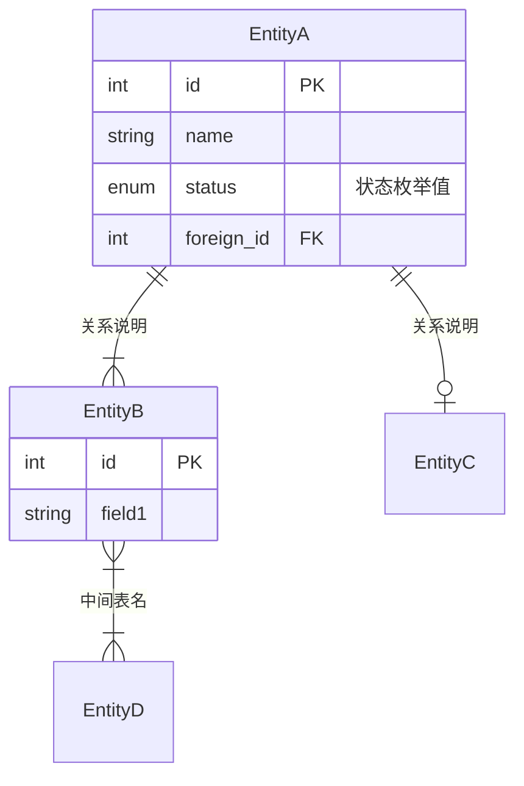
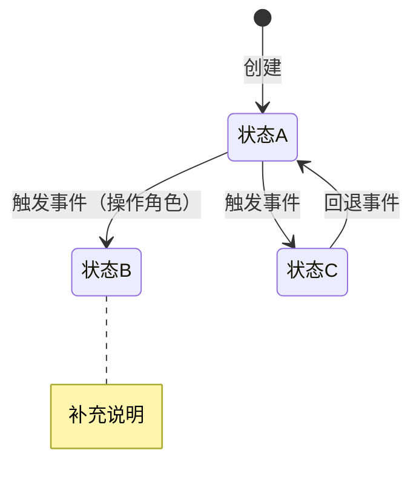

<!-- Derived from pmYangKun/create-prd-skill; modified by PM Agentic Cookbook contributors. SPDX-License-Identifier: Apache-2.0. See LICENSE and NOTICE. -->

# 第10章 功能需求 — 生成指引

> 生成 PRD 第10章"功能需求"的指引文件。这是 PRD 中最核心、最大的章节。

## 章节目标

以结构化方式详尽描述产品的功能设计，包括产品框架、功能详解和异常处理。

> 💡 方法论基础：
> - 产品框架：《决胜B端》自顶向下设计（框架图→数据模型→流程→页面→权限→字段）
> - 数据建模：《决胜B端》ER建模三步法（找实体→梳关系→定属性）
> - 流程设计：《决胜B端》UML 建模（泳道图 + 状态机）
> - 交互设计：《决胜体验设计》设计价值观 + 四大设计原则（有用、高效、容错、启发）
> - 规则描述：《决胜B端PRD模板》五种规则类型（事实、约束、触发条件、推论、计算）

## 生成结构

### 10.1 产品框架概述

图表载体按类型固定，**不做"视情况升级"的判断**——同一类图在任何 PRD 中载体一致：

| 图类型 | 载体 | 理由 |
| --- | --- | --- |
| **架构图三类**（系统框架图 / 应用架构图 / 功能模块架构图，以及 API 结构图） | **手绘 SVG** | 分层多节点结构，需要分层色带与分组嵌套，Mermaid 无法表达且必然连线交叉。三类图场景不同但结构范式与样式一致，选用与分层构成见 10.1.1 |
| **业务流程图**（10.1.3 总览 + 10.2.x.1 节点级） | **手绘 SVG** | 需要泳道、判定分支着色、跨泳道虚线联动 |
| **ER 数据模型** | Mermaid `erDiagram` | 关系语义图，自动布局足够，便于 diff |
| **状态机图** | Mermaid `stateDiagram-v2` | 状态语义图，同上 |

Mermaid 两类图仅当单图实体/状态数量过大导致渲染明显失真时才改 SVG，并在图注说明理由；架构图与流程图**无此条件分支，一律 SVG**。

**SVG 通用规范**（架构图与流程图共同遵循）：存放于模块文档目录的 `assets/` 下，以相对路径引用（需求文档与 `assets/` 同级时如 ``，需求文档在模块目录的子目录里时，从所在目录逐级上溯到模块文档目录，子目录有几层就上溯几层，如一层时用 `../assets/`）。模块文档目录取宿主契约的 `host.moduleDocs`（`<module>` 换成模块名），未声明时停下请用户指明；系统级需求文档不属于任何模块，图示放在它所在目录的 `assets/` 下。SVG 是版本化产物，后续修改直接编辑该文件。

> **绘制前必须加载项目的图示规范 spec**（形状字典、泳道规则、边标注密度、色板与样式类命名）。项目若尚无该 spec，先与用户确认基准并落成 spec，再开始绘制——不要凭既有图"目测仿色"。项目 spec 未定义的通用规则以本节为准。

**同一项目内所有 SVG 共用一套色板与 CSS class 命名**（架构图与流程图不分家）——绘制前先检索同项目既有 `assets/` 目录中的 SVG 作为视觉基准，不要另起一套。

### 业务流程图的信息密度要求（通用层核心规则）

流程图的价值在于让读者复原**真实**业务流转。只画主干、把环节概括成几个方框的图不满足要求，无论排版多干净。

**总-分结构**：10.1.3 产出覆盖全流程的总览图；10.2.x.1 为每个功能节点产出节点级详细流程图，详述该节点的具体环节、判定分支与回退/作废流转；总览图的泳道与主干节点集应覆盖各节点级图的主干，节点级图只做细化、不得与总览矛盾。

**泳道划分按参与方/系统**（非仅人的角色）：跨系统协作的流程必须让每个系统各占一道，跨系统交接因而显性化为跨泳道连线。纵向主干自上而下推进，跨泳道联动用虚线。

**形状即语义**（同一形状不得表达两种含义）：起止用胶囊；**处理步骤**（有人或系统执行动作）用实心矩形；**判定**用菱形且每条出边标注条件；**状态落地点**（流程在此产生一个可被对方角色/系统观察到的状态，本身不执行动作）用**卷角文档形**——把可观察状态画成普通矩形会掩盖"该节点是干活还是只记录结果"。

**一步一节点**（严禁压缩）：一个节点只画一个环节。**禁止把「A → B → C」多个步骤塞进一个节点的文字里**——压缩会丢掉每步各自的状态、校验与失败分支，使流程不可追溯。顺序步骤必须拆成逐个独立节点、用箭头串联，一步一框。

**主干走泳道中心线**：主干节点居中于泳道，只有旁路分支（阻断框、旁注）才横向偏移——这样相邻主干节点用垂直直线相连，不必绕折线。

**泳道宽度按内容自适应**：泳道不强制等宽；含判定+旁路阻断或宽节点的泳道自动加宽以容纳内容，只有主干的泳道保持最小宽。**绝不为迁就固定泳道宽而压缩节点、截断内容或让节点溢出到相邻泳道**。泳道整体宽度与标题栏对齐（左右边距统一）。

**连线路由**：同列→垂直直连，同行→水平直连，真跨行跨列→单拐点正交折线（按主方向选拐向），不走斜线、不走多拐 Z 字；箭头精确落在目标节点边界（矩形边中点、菱形顶点），不停半空。

> **首选用生成器出图**：`scripts/flowgen.py` 从数据(泳道/节点/连线)生成流程图，坐标、连线路由、箭头贴边、泳道自适应、样式全自动——上述规则由生成器"构造即满足"，不靠人逐图遵守。用法见 `scripts/flowgen_example.py`。手写 SVG 仅作生成器暂未覆盖的一次性布局的兜底；手写时你要对本节每条规则负责。

**连线标注的核心（"真实流转图"与"概括示意图"的分水岭）：动作标在边上，状态由目标节点承载，状态只写一处、不重复。**

- **状态在一处**：一次流转的结果状态，由边指向的**状态落地点节点**承载（该节点的存在意义就是承载可观察状态）；边只标动作/条件。**不要在边上再写一遍 `状态：…`**——两处都写既冗余、又会在短水平线上与动作字叠成一团，是常见缺陷。仅当边指向处理步骤/判定、且无状态落地点节点承接时，才在边上补一行状态。
- **状态值精确到子状态**：存在子状态时必须写出括号内容，只写父状态不合格。
- **跨系统连线必须标注接口编号与同步内容**，使该边可回指集成规范。
- **回退/驳回/补材等异常路径的标注密度与主干一致**（动作标签 + 状态落地点）——异常路径标注不足是最常见缺陷。
- 状态值必须与本 PRD 状态机、Domain Model 枚举**逐字一致**。
- **标签不得压节点、不得与相邻标签重叠**：短线（<80px）放不下标签时，把状态并入目标节点、或删去冗余动作词，不要硬叠。

**阶段分组与状态聚合**：跨泳道的子阶段用强调色虚线框整体圈出；多个并列终态/分支状态收敛到同一后继时，用强调色分组框聚合后引一条边出去，避免逐条连线交叉。

**完整性**：
- **一图仅一个开始节点、一个正常结束节点**。不要为图省事摆多个"结束"——先让分支汇合，再收束到唯一终点；阻断终止（`stop`）不受此限，可有多个（每个记录一种中止原因）。若唯一终点会逼出死循环，必须显式解开：该分支要么落到阻断终止，要么明确回到需重试的步骤，**绝不留下无法退出的环**。
- 除起止节点外每个节点必须有入边和出边，无孤立或断头节点（说明卡片是旁注，豁免）；判定的每条分支都必须落到状态落地点、终态、阻断终止或汇回主干，不得悬空。
- 箭头必须精确落在目标节点边界上，不得停在半空（把折线拆成"带箭头短线 + 后续 path"是最常见成因，应合并为单条 path）。
- **禁止两条连线共线重叠**：同一水平/垂直线上叠两条边会让读者分不清箭头属于哪条路径。一个节点向同方向扇出多条边时必须逐条错开（生成器会自动把后续分支下移并改从底边引出）。
- **每张图底部必须有图例条**，列出本图用到的每种图形及其中文名，加上两种连线（同泳道流转、跨泳道/系统联动），使读者不离开图就能读懂所有图形。
- 每张图在正文中都要跟一段文字版流程说明。

**可用图形**（生成器 `type` 值）：`start` 起止 / `step` 处理步骤 / `decision` 判断 / `state` 状态落点 / `subprocess` 子流程（进入其它流程）/ `data` 数据落点 / `database` 数据库 / `docstack` 文件落点 / `note` 说明卡片 / `stop` 阻断终止。

> **绘制完成后必须做两道校验，缺一不可：**
> 1. **运行结构校验脚本** `scripts/validate_flow_svg.py`（流程图默认 `--mode flow`，架构图 `--mode arch`）：查箭头落点、孤立节点、起止节点、文本粗略重叠——这些肉眼极难查全（十几像素偏差、漏画的分支终点、叠字）。
> 2. **渲染成 PNG 用眼睛看**（`qlmanage -t -s 1400 -o /tmp/ *.svg` 或浏览器）：脚本查不出标签是否互相拥挤、图例是否可读、箭头是否落在菱形尖点还是边上、整图是否清晰。**只跑脚本没渲染 = 没画完**——只跑脚本、不渲染，图例糊成一团、边字重叠都发现不了。
>
> 两道校验都干净了才算完成。脚本与渲染都不替代语义审查（状态值是否与 Domain Model 一致、泳道划分是否合理仍需人工与 check-prd）。

#### 10.1.1 架构图（三类，按文档范围选用）

架构图分三类，**场景与表达内容不同，不可相互替代**；但三者的**载体、分层结构范式与视觉样式完全一致**——都是手绘 SVG、都是"自上而下若干条色带 + 带内分组 + 节点"的框架结构、都沿用同项目同一套色板与样式类。

**A. 三类架构图的选用**

| 图类型 | 适用文档范围 | 回答什么问题 | 文件命名 |
| --- | --- | --- | --- |
| **系统框架图** | 0-1 系统级规划 PRD | 这个**系统**由哪些业务域/子系统/模块组成，它们如何分组与分层 | `{系统名}-系统框架图.svg` |
| **应用架构图** | 0-1 系统级规划 PRD | 这个**系统**在应用/技术上如何分层，请求如何自上而下贯穿，外部系统如何接入 | `{系统名}-应用架构图.svg` |
| **功能模块架构图** | 功能模块级 PRD | 这**一个模块**内部由哪些功能节点与平台能力构成，它在系统中的位置、上下游契约与数据边界 | `{模块名}-功能模块架构图.svg` |

- **系统级 PRD**：系统框架图与应用架构图**两张都要**——前者讲"有什么"（功能域全景），后者讲"怎么搭"（技术分层）。二者视角互补，不可只画其一充数。
- **功能模块级 PRD**：画功能模块架构图；若上位系统级 PRD 已有系统框架图/应用架构图，本模块图应能在其中定位到自己的位置，不重复绘制系统全景。
- **子功能级 Sub PRD**：**不新增架构层**，引用上级 Overview / 模块 PRD 的架构图，并用一句话声明本 Sub PRD 覆盖其中哪些节点。写法：`引用 [Overview 10.1.1 功能模块架构图](上级文档.md#1011-功能模块架构图)；本 Sub PRD 覆盖其中「X」「Y」节点与「Z」平台能力，不新增架构层。`
- **迭代需求**：沿用现有架构图；仅当本次迭代改变了架构层次或上下游契约时才更新图，并在修改记录说明改动点。

**B. 各类图的色带构成**（结构范式一致，层内容按类型定）

**系统框架图**——按业务域/能力域分带：

| 色带 | 内容 |
| --- | --- |
| 用户与角色 | 系统面向的角色群体与终端形态 |
| 业务域分组 | 若干条按业务域划分的色带（如主数据域、业务办理域、分析域），带内以 `grp` 圈出子域，节点为具体模块；标注模块间主要流向 |
| 平台与公共能力 | 权限、审批、消息、集成、审计等横切能力 |
| 基础数据与外部系统 | 主数据源、外部系统清单 |

**应用架构图**——按技术分层分带：

| 色带 | 内容 |
| --- | --- |
| 用户层 | 终端形态（PC Web / 移动端 / 开放 API 调用方） |
| 接入层 | 认证、鉴权、网关、路由 |
| 业务服务层 | 核心业务服务分组 + 平台能力分组 |
| 数据层 | 数据库、缓存、文件/对象存储、日志与审计存储 |
| 外部系统 | 通过接口/事件/回调交互的外部系统，标注集成方式 |

**功能模块架构图**——按本模块视角分带：

| 色带 | 内容 |
| --- | --- |
| 用户与接入层 | 本模块的使用角色（按角色隔离或分级列出）、终端形态、认证与权限校验入口 |
| 业务服务层 | 上半部为**核心业务分组**（本模块的功能页面/流程节点），下半部为**平台能力分组**（状态门禁、鉴权求值、校验网关等横切能力） |
| 数据层 | 本模块拥有的数据实体、只读消费的外部主数据、审计/日志类存储 |
| 外部系统与相邻模块 | 上下游模块及其契约摘要（只读 / 事件 / 回调 / 交付物），标注读写方向 |

**C. 三类图共同的生成规则**

正文引用写法（三类相同，替换文件名即可）：

```md


{图后附分层文字说明：逐层交代该层承载什么、与相邻层的关系}
```

- SVG 用 `<defs><style>` 定义样式类（色带 `band`、分组 `grp`、节点 `box`、平台能力 `plat`、数据 `db`、外部 `ext`），节点复用类而非逐个内联样式，便于后续编辑与跨图一致
- **配色与样式类沿用同项目既有 SVG**（先检索 `assets/` 目录取基准）；无既有产物时，本图的色板即成为该项目后续所有 SVG（含流程图）的基准。三类架构图之间尤其必须同色板——它们常被并列阅读
- 色带内分组用浅色底 `grp` 圈出，组名左上角标注
- 跨层流向用实线箭头，旁路/求值/事件类联动用虚线箭头，箭头旁标注关系名
- 节点文字超过一行时用 `<tspan x="…" dy="…">` 换行，副说明用更小字号
- 外部系统节点下方用 `note` 小字标注契约摘要（如"主数据只读""定稿交付"）
- 图后必须附分层文字说明，不能只放图

#### 10.1.2 数据模型图或数据模型引用

系统级 PRD 或缺少前置数据模型时，使用 Mermaid `erDiagram` 语法，同时保留实体说明表格作为补充。

功能模块级 PRD 如果已有 Domain Model、ER 文档或数据模型文档，应优先引用既有模型，不重新发明完整 ER。此时输出“本功能涉及实体表”和“数据读写边界表”，只在确有必要时补充局部 ER。

> 💡 ER建模三步法：找到实体 → 梳理关系 → 确定关键属性

模板：

````md

````

**关系符号说明：**
- `||--||` 一对一
- `||--|{` 一对多
- `}|--|{` 多对多（通过中间表）
- `||--o|` 零或一对一

**生成规则：**
- 0-1 系统级业务型/交易型产品：ER图必须完整，所有核心实体和关系都要画出
- 功能模块级或子功能级 PRD：优先引用已有 Domain Model；只展开本功能涉及实体、字段、状态和读写边界
- 如果 PRD 发现数据模型缺口，输出“数据模型反馈项”，不要在 PRD 中私自修改既有模型口径
- 每个实体列出关键属性（PK/FK/状态/核心业务字段）
- 关系标注业务含义
- ER图后面附实体说明表格（补充属性细节和业务规则）

功能模块级模板：

```md
#### 10.1.2 本功能涉及实体与数据边界

| 实体 | 来源文档 | 本功能动作 | 关键字段/状态 | 说明 |
| --- | --- | --- | --- | --- |
| {EntityA} | {Domain Model 路径或章节} | 只读/新增/更新/锁定/归档 | {字段} | {规则} |

| 数据流 | 上游 | 本功能处理 | 下游 | 一致性约束 |
| --- | --- | --- | --- | --- |
| {数据流名称} | {上游模块} | {校验/计算/确认} | {下游模块} | {幂等/版本/锁定} |

**数据模型反馈项：**
- [TODO/无] {如发现既有模型缺少字段、状态或关系，在此列出}
```

#### 10.1.3 核心业务流程图

统一使用**手绘 SVG 图片**（总-分结构的"总"）：概括全流程环节与跨节点汇入关系，节点细节下沉到 10.2.x.1 节点级图。

**生成规则：**
- 分层/泳道布局：按角色或功能域分泳道，每条泳道纵向主干自上而下；跨泳道联动、系统触发用虚线边；平台级前置能力（如状态门禁）可画为横贯顶部的虚线带
- 节点符号：起止用椭圆、判断用菱形、普通步骤用圆角矩形；着色语义固定——蓝=主流程步骤、浅蓝=入口/系统触发、绿=成功/终态、红=失败/阻断
- 每条边带箭头，分支边标注条件；除起止节点外每个节点必须有入边和出边
- 节点文字简洁，可附业务规则编号辅助定位；图底附图例（实线/虚线含义）与指向节点级图的引用
- 文件存模块 `assets/`，命名 `模块名-核心业务流程图.svg`，Markdown 相对路径引用；沿用项目既有流程图 SVG 的配色与样式类

#### 10.1.4 状态机图

使用 Mermaid `stateDiagram-v2` 语法，同时保留状态转换表格作为补充说明。

模板：

````md

````

**生成规则：**
- 为每个有状态流转的核心实体画一张状态机
- 包含正常路径和异常路径（回退、超时等）
- 用 `note` 标注关键约束
- 状态机图后附状态转换明细表（当前状态→触发事件→目标状态→操作角色→备注）

#### 10.1.5 功能清单

| 子系统 | 页面 | PC端 | H5端 | App端 | 说明 |
| --- | --- | --- | --- | --- | --- |
| {子系统A} | {页面1} | ✓ | — | — | |
| {子系统A} | {页面2} | ✓ | ✓ | — | |

### 10.2 产品需求详解

对每个功能模块，按以下结构生成：

```md
### 10.2 产品需求详解

#### 10.2.1 {模块名称}功能详解

##### 10.2.1.1 业务流程图

{节点级详细流程图：手绘 SVG（总-分结构的"分"，样式与 10.1.3 总览图一致），详述本功能节点的具体环节、判定分支、阻断与回退/作废流转。每条边按 10.1 信息密度要求标注「动作/接口」+「状态：精确状态值（含子状态）」，异常与回退路径同密度；图后附文字版流程描述。文件存模块 `assets/`，命名 `模块名-{功能节点名}流程图.svg`}

##### 10.2.1.2 页面交互

**{页面名称}**

> 💡 设计原则：有用 > 高效 > 容错 > 启发
> 💡 页面字段级规则（字段格式、校验、联动、按钮状态、控件交互态、状态文案）是研发、测试、设计都无法替产品经理决定的内容。详细需求级 PRD 缺失这一层即不具备开发条件，不得只写"支持查询/支持编辑"一句带过。

**页面交互规则块（A-I）**：按文档范围选做（见下方"适用范围分级"）。

**A. 页面结构（区域 × 内容 × 交互）：**

| 区域 | 内容 | 交互 |
| --- | --- | --- |
| {顶栏/提示条/Tab/筛选区/列表/分页} | {元素清单，含按钮名} | {触发方式、区域间联动、切换时的保留与丢弃规则} |

**B. 查询条件与筛选控件规则：**

| 控件 | 字段类型 | 输入限制 | 触发规则 | 错误/空态 |
| --- | --- | --- | --- | --- |
| {搜索框} | 文本 | {长度上限、trim、禁止换行} | {回车/点击查询/选择即查} | {无结果文案} |
| {状态筛选} | 单选/多选下拉 | {默认选中项} | {是否自动提交} | {无权限选项的隐藏规则} |
| {查询/重置按钮} | 按钮 | — | {loading 防重复；重置后页码与条件的复位} | {失败 toast 文案} |

**C. 列表字段级规则：**

| 字段 | 显示格式 | 交互/校验 | 权限与状态 |
| --- | --- | --- | --- |
| {字段名} | {文本长度上限/日期格式/金额精度/枚举 Badge 颜色/空值占位符} | {超长省略+悬停完整值、可复制、点击下钻、排序} | {只读来源/可编辑条件/脱敏规则} |

**D. 表单/详情字段级规则**（新建、编辑、详情视图的每个字段）：

| 分区 | 字段 | 读写 | 控件/格式 | 必填条件 | 校验与联动 |
| --- | --- | --- | --- | --- | --- |
| {分组名} | {字段名} | 只读/可编辑/条件可编辑 | {控件类型、格式、精度、默认值} | {恒必填/条件必填（写清触发条件）} | {范围、上限、跨字段联动、失焦格式化、错误文案} |

**E. 操作按钮与行操作规则**（页面级按钮 + 行操作 + 弹层按钮全覆盖）：

| 按钮 | 展示条件 | 点击反馈 | 阻断条件 | 禁用态表现 |
| --- | --- | --- | --- | --- |
| {按钮名} | {权限、数据状态} | {loading、toast、跳转、二次确认} | {校验失败项清单} | {置灰 + 悬停 Tooltip 展示禁用原因} |

**F. 弹窗/抽屉/页面容器规范：**
- 容器类型选择（Modal / Drawer / 新页面 / Toast）及理由；宽度或尺寸档位。
- 只读模式与编辑模式的按钮组差异；顶部固定信息与 sticky 规则。
- 未保存变更时关闭/切换的二次确认文案；保存中的 loading 与防重复提交。

**G. 控件交互五态基线**（默认 / 悬停 / 聚焦或点击 / 错误 / 禁用）：

| 元素 | 默认态 | 悬停态 | 聚焦/点击态 | 错误态 | 禁用态 |
| --- | --- | --- | --- | --- | --- |
| {文本输入框/数字输入框/下拉框/日期选择器/表格行操作/主按钮/次按钮} | | | | | |

> 全局基线在系统级或 Overview 层登记一次即可；页面级只登记与基线的差异，避免逐页重复。

**H. 页面状态与文案：**

| 状态 | 触发条件 | 文案/交互 |
| --- | --- | --- |
| 首次加载 | {请求中} | {骨架屏/加载指示} |
| 空数据 | {无数据} | {业务化空态文案 + 引导动作} |
| 搜索无结果 | {筛选无结果} | {文案} |
| 无权限 | {整页无权限} | {文案} |
| 部分权限 | {有列表权限无敏感字段权限} | {字段级脱敏表现} |
| 加载/保存失败 | {后端或网络失败} | {toast 文案 + 字段级错误定位} |

**I. 敏感字段展示口径（如适用）：**
- 脱敏格式（写出具体掩码样式）、临时查看/隐藏交互、导出是否同口径脱敏、查看留痕要求。

**适用范围分级：**

| 文档范围 | 必做规则块 |
| --- | --- |
| 子功能详细需求 / 迭代需求 | A-I 全做；每个页面、每个弹层逐一覆盖 |
| 功能模块级需求 | 至少 A-E + H；G 可引用全局基线 |
| 0-1 系统级规划 / Overview PRD | 不做页面级明细；登记全局交互基线（G）与 Sub PRD 必须覆盖 A-I 的下钻要求 |

**字段级规则的最低粒度**（每个可编辑字段缺一不可）：控件类型、格式与精度（长度上限/小数位/日期格式）、默认值、必填条件（含条件必填的触发条件）、校验规则与错误文案、跨字段联动；只读字段须写明数据来源与是否脱敏。信息不足时保留表格骨架并标注 `[TODO: 需产品经理定义]`，不得编造具体数值后不作标记。

##### 10.2.1.3 业务规则

> 💡 规则五种类型：事实、约束、触发条件、推论、计算

| 编号 | 规则类型 | 规则描述 |
| --- | --- | --- |
| R1 | 约束 | {如：订单金额不可为负数} |
| R2 | 触发条件 | {如：当库存低于安全库存时，自动触发补货提醒} |
| R3 | 计算 | {如：订单总额 = Σ(商品单价 × 数量) - 优惠金额} |

##### 10.2.1.4 验收标准

| 验收标准（清单名称加编号） | 场景类型 | Given | When | Then |
| --- | --- | --- | --- | --- |
| {清单名称 AC-n} | 正常流 | {合法角色、合法数据、开放状态} | {执行操作} | {所引用标准的一项可观察结果} |
| {清单名称 AC-n} | 异常流 | {缺失/重复/冲突数据} | {执行操作} | {所引用标准的一个异常结果} |
| {清单名称 AC-n} | 权限流 | {无权限角色或越权数据} | {访问/操作} | {所引用标准的一项拒绝或不可见结果} |
| {清单名称 AC-n} | 锁定态 | {对象已审批/锁定/归档} | {尝试修改} | {禁止修改或进入解锁流程} |
| {清单名称 AC-n} | 幂等流 | {重复提交/导入/同步/回调} | {再次执行} | {不产生重复业务结果} |
```

### 10.3 异常情况处理方案

```md
### 10.3 异常情况处理方案

| 异常类型 | 异常场景 | 处理方案 |
| --- | --- | --- |
| 网络异常 | 提交操作时断网 | 本地暂存，恢复后自动重试/提示重新提交 |
| 并发冲突 | 多人同时编辑同一记录 | 乐观锁 + 冲突提示，后提交者需刷新确认 |
| 数据异常 | 外部系统返回错误数据 | 校验拦截 + 错误日志 + 人工处理入口 |
| 误操作 | 误删除重要数据 | 软删除 + 回收站 / 操作确认二次弹窗 |
| 业务异常 | 审批超时无人处理 | 超时提醒 → 升级提醒 → 自动转派 |
| {其他} | | |
```

## 生成规则

### 10.1 产品框架

1. **架构图**：按文档范围选类（系统级=系统框架图+应用架构图两张；功能模块级=功能模块架构图；子功能级=引用上级不新增），从第5章的功能模块表展开为色带结构，**均为手绘 SVG 且同色板**（10.1.1）。
2. **数据模型**：
   - 从业务描述中识别核心名词作为实体候选。
   - 用ER三步法：找实体→梳关系→定属性。
   - **系统级业务型/交易型**产品：ER模型必须完整，这是设计的基石。
   - **功能模块级/子功能级**需求：优先引用已有 Domain Model，避免 PRD 与数据模型漂移。
   - **工具型/基础服务型**：简化数据模型，重点在功能接口。
   - 关系要标注精确的基数（1:1, 1:*, *:*），不能模糊。
   - 考虑未来扩展性：宁可设计为*:*用中间表，也不要后期改模型。
3. **业务流程图**：**手绘 SVG** 泳道图（10.1.3 总览 + 10.2.x.1 节点级），至少覆盖主流程、关键分支与异常路径，图后附文字版流程描述。
4. **状态机**：为每个有状态流转的核心实体画状态机，包含正常和异常路径。
5. **功能清单**：用表格列出所有页面和多端支持情况。

### 10.2 需求详解

1. **每个模块**都按"流程图→页面交互→业务规则"三段式结构。
2. **页面交互**按 A-I 规则块生成，覆盖深度按"适用范围分级"表执行；详细需求级 PRD 的每个页面和弹层都要有字段级规则表，不得合并或抽样。
3. **业务规则**必须按五种类型分类：事实、约束、触发条件、推论、计算。
4. **验收标准**每行引用已确认清单名称与编号，将其细化为页面Given/When/Then，覆盖适用的正常、异常、权限、锁定及幂等场景。未被清单覆盖的新业务预期先回改上游并确认，不直接新增无来源的验收行。
5. 如果信息充足，生成具体字段和规则；如果不足，生成表格框架并标注 `[TODO]`。
6. **规则块间一致性**：E 表中每个按钮的阻断条件必须与 D 表校验规则、10.3 异常方案对应得上；H 表状态枚举必须与状态机和列表字段的枚举一致；页面中出现的每个按钮必须能在第 12 章权限矩阵中找到行。
7. **状态可达与派生优先级**：状态机的每个人工迁移必须落到某个页面的操作入口（写清按钮、前置条件、二次确认文案），系统迁移写明触发器；系统派生状态（红绿灯、健康度类）必须定义多条件同时命中时的展示优先级。
8. **无悬空引用**：Tab、入口按钮、业务规则引用到的每个页面/列表/弹层，都必须在本 PRD 内有规格或明确引用其所在文档；不允许"办理抽屉写全了、承载它的列表页不存在"。

### 10.3 异常处理

1. 至少覆盖：网络异常、并发冲突、数据异常、误操作、业务异常 5类。
2. 每种异常有具体的处理方案，不是"待后续补充"。

### AI 功能设计（如适用）

如果产品包含 AI 功能，在对应模块的需求详解中额外加入：

```md
##### AI 功能设计

> 💡 确定性-容错性四象限分析 + 六脉神剑交互模式选择

**任务特征分析：**

| 分析维度 | 评估 |
| --- | --- |
| 确定性 | 高（目标明确）/ 低（探索性） |
| 容错性 | 高（允许出错）/ 低（必须准确） |
| 推荐交互模式 | {六脉神剑中的具体模式} |

**AI 交互设计：**
- **交互模式**：{封装API / CUI嵌入GUI / Chat / Copilot / 辅助填充 / 后台自动化}
- **人机边界**：{哪些步骤AI执行、哪些需要人确认、哪些必须人操作}
- **降级方案**：{AI 不可用时的回退方案}
- **监控指标**：{准确率、使用率、弃用率等}
```

## 不同产品类型的侧重差异

| 功能类型 | 10.1 侧重 | 10.2 侧重 | 10.3 侧重 |
| --- | --- | --- | --- |
| 业务型 | ER图+流程图+状态机都必须完整 | 每个模块的角色交互和审批流程 | 审批异常、数据一致性 |
| 工具型 | 简化模型，强调使用流程 | 操作效率和快捷方式 | 数据丢失防护、撤销操作 |
| 交易型 | ER图+交易流程图+状态机 | 交易闭环各环节的规则 | 支付异常、库存并发、对账 |
| 基础服务型 | API结构+调用流程 | 接口规范和参数说明 | 服务降级、限流、重试 |

## 质量标准

- [ ] 10.1 架构图按文档范围选类齐备（系统级=系统框架图+应用架构图；模块级=功能模块架构图；子功能级=显式引用上级图并声明覆盖节点），且有功能清单
- [ ] 架构图与业务流程图均为 SVG 且样式与项目图示 spec / 既有 `assets/` 产物一致；ER 与状态机为 Mermaid
- [ ] 流程图达到信息密度要求：泳道按参与方/系统划分；形状区分处理步骤与状态落地点；**每条边标注动作/接口 + 精确状态值（含子状态）**；异常回退路径标注密度与主干一致；边上状态值与状态机/Domain Model 逐字一致
- [ ] **已运行 `scripts/validate_flow_svg.py` 且全部通过**（流程图 `--mode flow`，架构图 `--mode arch`）：箭头落点无指空、无孤立节点、起止节点齐备、无文本重叠
- [ ] **已渲染成 PNG 并目视确认**：标签不拥挤、图例可读、箭头贴节点、整图清晰——脚本查不出这些，必须眼睛看
- [ ] 10.1 系统级业务型/交易型产品有完整ER模型；模块级 PRD 已引用或局部说明数据模型
- [ ] 10.1 有状态流转的实体都有状态机
- [ ] 10.2 每个模块按"流程→交互→规则"三段式
- [ ] 10.2 页面交互按 A-I 规则块生成，深度符合"适用范围分级"
- [ ] 10.2 详细需求级 PRD：每个可编辑字段有控件/格式/必填条件/校验/错误文案，每个按钮有展示条件/反馈/阻断/禁用原因，每类页面状态有文案
- [ ] 10.2 规则按五种类型分类
- [ ] 10.2 验收标准覆盖正常、异常、权限、锁定、幂等场景
- [ ] 10.3 至少覆盖5类异常场景
- [ ] AI功能（如有）使用了四象限+六脉神剑框架
