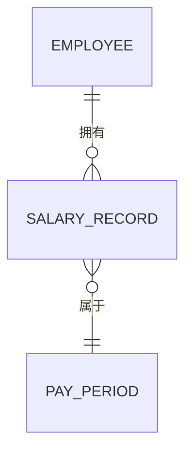
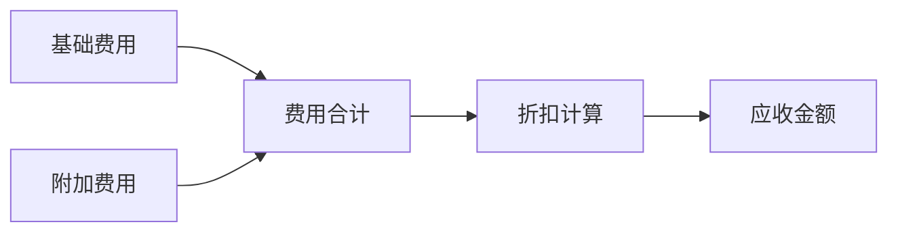

# domain-modeling

为 ToB 产品完成从业务需求到结构化数据模型的全链路设计。

这项技能的核心价值在于：在编码之前，先用产品架构师的视角把业务"想清楚"。一份好的数据模型是所有后续工作（PRD、原型、开发）的地基。如果实体关系理不清，后续所有工作都会反复返工。

## 输入

- 用户提供的业务需求描述（自由文本、会议纪要、简要描述等均可）
- 或通过文件路径传入的需求文档
- 阶段零整理并初步确认的需求范围说明及交叉依赖；直接建模请求缺该说明时先提示补齐阶段零依据，不自行猜交付范围

调用方随调用给出的参数，优先作为输入源。

## 建模流程

严格按以下 5 步执行。每步完成后立即输出该步的成果，不要等全部完成再输出。

涉及审批/调整单与实际生效值分层、历史区间重分段、条件集合或一对多事件同步时，额外加载：

[时态事实、集合载体与事件投递建模](references/temporal-and-event-modeling.md)

### 第一步：识别核心实体

从业务需求中提取所有关键的 **业务实体**（Entity）。

之所以要求列出生命周期，是因为 ToB 系统中几乎所有核心实体都有审批、生效、归档等状态流转，遗漏这些会导致后续流程设计出现断层。

每个实体需包含：

| 字段 | 说明 |
|------|------|
| 实体名（中文） | 业务可读的名称 |
| 实体名（英文） | 用于代码层/数据库表命名，采用 PascalCase |
| 业务描述 | 一句话说明该实体的业务含义 |
| 生命周期 | 创建 → 审批 → 生效 → 归档 等状态流 |
| 数据量级预估 | 少量（<1K）/ 中等（1K-100K）/ 大量（>100K） |

### 第二步：定义字段规范

对每个核心实体，列出其关键字段。字段定义的精确度直接决定了开发阶段的沟通成本——定义越模糊，联调时的扯皮越多。

| 字段名 | 类型 | 是否必填 | 业务规则 | 来源 | 索引建议 |
|--------|------|----------|----------|------|----------|
| 示例：basic_salary | Decimal(10,2) | 是 | 必须 > 0 | 用户输入 | 否 |

字段定义约束：
- 金额类字段统一使用 `Decimal` 类型，精度至少 2 位小数
- 状态类字段使用枚举（Enum），必须列出所有可能的值及其含义
- 关联字段必须标注外键关系和级联行为（CASCADE / SET NULL / RESTRICT）
- 时间类字段统一使用 `TIMESTAMP WITH TIME ZONE`
- 每个实体必须包含 `created_at`、`updated_at`、`created_by`、`updated_by` 审计字段

### 第三步：绘制 ER 关系

用 Mermaid `erDiagram` 语法输出实体关系图。

标注以下关系类型：
- `||--||` 一对一
- `||--o{` 一对多
- `}o--o{` 多对多（需标注中间表及其业务含义）



ER 图输出后，附一张**关系明细表**，列出每对关系的业务含义、关联键和维护规则。

完成后，运行 `scripts/validate_mermaid.py` 验证 Mermaid 语法的正确性。

### 第四步：梳理计算链路

如果实体之间存在 **计算依赖**，用 Mermaid `flowchart` 标注数据流向。

计算链路是 ToB 系统中最容易出 bug 的地方——因为一个字段的变更可能触发一连串下游重算。提前梳理清楚，能大幅减少后续的联调问题。



对每条计算路径，补充说明：
- **触发时机**：何时重新计算（实时 / 批量 / 手动触发）
- **幂等性**：重复计算是否产生相同结果
- **循环依赖检查**：确认不存在 A→B→C→A 的循环

### 第五步：业务规则清单

以表格形式列出所有 **硬性业务规则**：

| 规则编号 | 规则描述 | 涉及实体 | 触发条件 | 校验方式 | 违反后果 |
|----------|----------|----------|----------|----------|----------|
| BR-001 | 应收金额不可为负数 | ChargeRecord | 保存时 | 前端+后端双重校验 | 阻止保存并提示 |

业务规则是系统的"法律"，写得越明确，开发和测试团队的理解偏差就越小。

交付模型前，用实体、关系、状态、业务规则及共享依赖验证候选范围：各自是否有业务结果与独立验收出口，是否漏了共同闭环，依赖契约和就绪条件是否明确。提出必要的合并、拆分或依赖调整，用户确认后同步原范围说明与模型。业务实体按业务事实建模，不为验收分组重复、合并或拆造实体；一个范围可引用多个模型，共享模型可供多个范围引用。

用户确认模型及最终范围后交接给验收标准阶段。交接包含范围名称、包含/排除、依赖、验收出口、范围说明与模型版本、清单/台账归集位置；同时写明共享模型可复用、一范围可关联多模型/PRD，模块入口只索引范围、关联模型/PRD、标准清单、台账及进度，不重复维护标准明细。验证建议与交接都须保留这一归属边界。确认可在同一节点完成。范围仍是候选或依赖含义未定时交用户裁定，不宣告标准生成前置条件已齐。

---

## 使用示例

### 输入（PM 提供）
```
我们需要设计一个费用结算模块，包含：
1. 客户的计费档案管理
2. 每月费用计算与出账
3. 年度费用计划编制（按多个业务属性分表）
```

### 预期输出
AI 将依次产出：
1. 核心实体清单（Customer, ChargeProfile, ChargeRecord, PlanSheet...）
2. 每个实体的完整字段定义表
3. Mermaid ER 关系图 + 关系明细表
4. 计算链路流程图 + 触发时机说明
5. 业务规则清单

---

## 质量自检

完成建模后，用以下问题自查：
- [ ] 每个实体是否都有唯一标识（主键）？
- [ ] 所有金额字段是否使用了 Decimal 类型？
- [ ] 状态字段的枚举值是否完整覆盖了业务场景？
- [ ] 实体之间的关联关系是否都标注了级联行为？
- [ ] 是否存在冗余实体或字段？
- [ ] 计算链路中是否有循环依赖？
- [ ] 审计字段（created_at/updated_at/created_by/updated_by）是否齐全？
- [ ] Mermaid 图是否通过了 `scripts/validate_mermaid.py` 的语法校验？
- [ ] 数据量级预估是否会影响索引和分区策略？
- [ ] 办理对象与下游读取的生效事实是否分层？
- [ ] 时间区间实体粒度是否与不重叠不变量一致？
- [ ] 条件集合是否有权威关系实体和下游快照？
- [ ] 历史重分段是否保留 immutable 前后值证据？
- [ ] fan-out 事件是否冻结目标集合并支持逐目标补偿？
- [ ] 需要可靠通知下游时，业务事实、执行凭证与 Outbox 是否同事务，并使用稳定 event ID？
- [ ] publisher retry 是否只重试投递，consumer 与 poison event 是否支持幂等、可见失败和同 ID replay？

## 停机条件

同时满足才算完成：

1. 质量自检各项都有结论；不适用的写明理由
2. 图示通过语法校验
3. 实体、关系、计算链路与业务规则都能追溯到输入材料；推断得来的明确标出
4. 候选范围及共享依赖已通过模型验证；必要调整已说明并交用户确认，最终范围与模型交接状态明确

**停下交用户**：输入材料之间冲突；缺少判断实体边界或计算口径所必需的业务事实；同一处语法校验修两次仍不通过。

不宣告"模型已定稿"。
